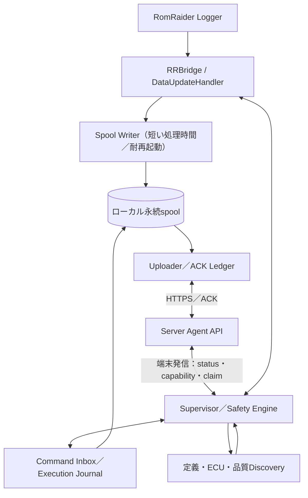

# DD-AGENT-001 Windows車載クライアント詳細設計

| 項目 | 内容 |
| --- | --- |
| 文書ID | RLG-DD-AGENT |
| 版 | 1.0.0 / 2026-10-12 |
| 状態 | **実装前の設計。既存RRBridge再利用は第一候補、実ECUの全経路試験は未完了** |
| 正本 | RomRaiderServer側の本書（RomRaider_agent側からリンク） |
| 上位 | [基本設計](basic_design.md)、[通信v1](interfaces/server_agent_wire_v1.md)、[安全設計](safety_validation.md) |

## 1. PoC再利用の方針

最も開発コストがかかる可能性のある**RomRaider内部への接続**は、既存のRRBridge Java Agentを第一候補とする。`-javaagent`とRomRaiderのDataUpdateHandlerへのフックで、CSV記録ON/OFFに依存しない観測値取得を目指す。

| PoC要素 | 製品設計上の扱い |
| --- | --- |
| `Agent.java` 既存のloggerアクセス・プロファイル操作 | 可能な限り再利用。ただし許可操作と安全条件を見直す |
| `Stream.java` のサンプル取り出し／定義通知 | フックの再利用を優先。取得の安定性とイベント粒度を実ECUで検証 |
| PoCのTSV spool、送信済み位置`.sent`、任意2xxをACKとみなす転送 | **そのまま採用しない**。原本ID＋正しいACK台帳／部分隔離が必要 |
| `LinkMonitor.java` 等の接続品質 | 再利用候補。実ECU取得停止との区別を確認 |
| `server/` PoC | Server正本へはコード再利用の要否だけ判断。二重サーバーの維持はしない |
| PoCの固定profiles・項目数20・guard 2Hz等 | 例示値。製品の普遍的な固定閾値にはしない |
| `SelfTest` | 単体試験資産として活用し、正式通信v1用契約試験を追加 |

現行PoCの安全な拒否・実ECU未確認の状態を保ったまま、新しい製品契約を**別版として移行**する。旧C1〜C14と製品v1の送信・受信形式は自動互換とみなさない。

## 2. 論理構成

**論理境界であり、全ボックスを別プロセスへ分離する必要はない。** 初期版はJava Agentが取得・spool、軽量なAgentワーカーが転送を担う方法を基本候補とする。Java Agent内部で転送も実装してもよいが、RomRaiderのDataUpdateHandlerコールバックでHTTP応答待ちしてはいけない。Supervisorが後から合流してもデータ経路を差し替えなくてよいよう、保存済みspoolをローカルの引渡境界とする。

## 3. 起動モード・起動順序

### 3.1 手動モード

- 通常のRomRaider単独利用であり、AI連携機構とサーバー接続を必須にしない。
- 製品側で手動モードのログ収集をオプションとして提供してもよいが、RomRaider本来の操作を上書きしない。
- 起動方法でモードを選ぶ。実行中の動的なモード変更は要求しない。
- 端末の任意パスやBP5固有値を固定設定しない。

### 3.2 AI連携モード

1. 車載端末の設定・資格情報・ローカルspool／実行台帳を読み込み、前回未完了の記録を回復。
2. RomRaider起動時にRRBridgeを組み込み（PoC再利用候補）。接続中／ログ開始待ちと**実サンプル取得**を別の状態として扱う。
3. Logger定義・ECUを可能な限り自動識別。できない部分はunknownとして報告。
4. 前回の実機適用状態と前回の未完了操作を照合する。Serverにつながらなければ最後に正常確認したロギング構成で継続。新しいAI操作は適用しない。
5. spool保存、最新優先と履歴回収の転送、状態報告を開始。AIが接続していない間も基本計測。
6. 有効で承認済みの計測タスクがあり、互換・安全条件・ユーザー介入が許せば計画を適用する。

**未登録資格情報・サーバー不達・ECU不応答**を混同しない。サーバー不達でも取得可能なロギング機能は続け、端末での設定異常が取得不能の直接原因なら診断可能な状態とする。

## 4. Spoolの物理方式

### 4.1 初版選定

**ローカルSQLite WALを車載側spoolと確認済みID台帳の候補正本として採用する。**

理由は、任意順序の送信・部分隔離、再起動後のACK集合、最新優先、途中失敗、複数run混在を単一ファイルオフセットより確実に追跡できること。Windowsで運用できる安定したライブラリを用い、既存のロガーフック側に過剰な依存を作らない。

必要ならJava AgentからJDBC経由で書き込む、またはRRBridgeが短いローカルIPCで別プロセスの耐久writerへ渡す。**IPCの受信成功を耐久保存成功と見誤らない**。Java側のフック安定性、SQLite依存物の配布ライセンス、実測負荷で最終方式を選定する。PoCのTSVが既に要件を満たせる場合には部分的再利用も可。

### 4.2 ローカル論理表とACK状態

| 論理表 | 主なキー／カラム | 用途 |
| --- | --- | --- |
| `spool_records` | record_id、run_id、segment_id、sequence、captured_at、kind、source_kind、immutable payload、content_hash、persisted_at | 未ACKとACK済みの同一性を保持 |
| `spool_profiles` | profile_revision_id、definition fingerprint、immutable definition、server_registered flag | 後から定義送信・再登録可能 |
| `spool_delivery` | record_id PK、state（pending/inflight/acked/quarantined）、last_attempt、attempt_count、last_error | 任意順序の再送／隔離／確認 |
| `spool_batches` | batch_id PK、送信レコードID集合、本文hash、状態、時刻 | timeout後の不明結果と同一本文再送 |
| `local_commands` | command_id PK、plan_revision、受信／開始／終了、指示内容hash、結果、current_profile | 再起動後の二重実行防止 |
| `local_state` | 起動モード、AI停止フラグ、Logger状態、last verified profile、未完了操作 | オフライン時の局所判断 |
| `quality_events` | event UUID、run_id、drop_count／gap、原因、報告状態 | 異常情報の保全とServer同期 |

SQLiteは`journal_mode=WAL`、**耐久性が必要なトランザクションは`synchronous=FULL`**を初期候補とする。ローカルwriterの単一書込み（または明示的にロック制御）で、取得スレッドを長いDB/HTTP処理で塞がない。耐電源断性は媒体・Windowsのフラッシュ特性にも依存するため、無条件な無損失とは言わない。

### 4.3 保存の順番

1. RRBridgeのデータ更新通知で観測時刻、順序、run UUID、segment UUID、profile revision、source_kindを確定し、不変record UUIDを付与。
2. DataUpdateHandlerから短時間でwriterへ渡す（シリアライズ／計測を停止させない）。キュー容量とドロップ件数を観測。
3. writerが不変payloadとdelivery=pendingを**同一SQLite transactionで永続化**。ここがローカル保全確定点。
4. Uploaderは**保存済みデータだけ**を選び、現在の送信バッチ集合・内容hashを台帳に記録してHTTPへ送る。
5. Serverの`status=committed`、batch_id、件数一致を検証してから、該当record_idを同一ローカルtransactionでackedにする。
6. ACK済みの元レコードとdelivery行は容量回収可能。ただし同じIDを再送する可能性のある`spool_batches`の参照整合や破損復旧に注意する。
7. 422の不正レコードは**永続quarantine**へ移し、元の内容／IDを変えず、その他の正常レコードだけ新batch_idで再編成する。隔離レコードを無断削除しない。

**ACK処理は連続ファイル位置だけで表現しない。** 最新優先転送・後着データ・異なるrunの混在を前提に、record IDごとに確定情報を保つ。

## 5. 転送スケジューラ

初版の単純な公平性ルールとして、**最新候補バッチ1回・滞留最古候補バッチ1回を交互に選択**する。どちらかが空なら残る側を連続実行してよい。

- 新しい観測をすぐ送信し、スプールに大きくたまることを待たない。
- 過去の回収バッチも必ず処理機会を持ち、長時間通信断後も最古データが飢餓にならない。
- 過去データの新規到着と最新値の順序前後はServer側のrun/sequenceで再構成。
- バッチはv1契約の最大128件・256KiB初期目安。サイズ上限を超える場合は小分けする。HTTPタイムアウト、429/503、Retry-After、指数バックオフを利用。
- 進行不能な異常バッチを無制限再送せず、問題レコード隔離で正常な他レコードを進める。
- SQLiteのvacuum／チェックポイントはwriterを塞がないタイミングに実行。未ACK容量を減らすための強制削除は禁止。
- サーバーからの端末認証拒否時に無制限接続連打をしない。計測とspool保存自体は継続する。
- 再起動後、inflightと結果不明は未ACKに戻し、再送で冪等に確定させる。

**注意:** この交互方式は帯域を平等に利用できる設計初期値。最新の観測量が送信可能帯域を超える場合、常時リアルタイムを保証できない。その際は滞留量と最新遅延を記録し、品質異常にする。正常通信時P95 2秒以内は暫定試験目標であり実機保証ではない。

## 6. ディスク満杯・突然終了・破損時の扱い

| 状況 | 振る舞い |
| --- | --- |
| スプール容量が警告しきい値へ到達 | ログ・状態・必要に応じ外部イベントとして通知。OS領域の保護を優先 |
| ローカル保存が不能 | データが永続化されたと偽らない。取得中断、drop_countと失敗範囲の記録を試みる |
| 非同期writerキュー満杯 | ドロップ数と原因を追跡し、黙って新しい観測を捨てない |
| Agent突然終了 | ローカルtransaction確定分から未ACKを復元、未完了操作はunknown |
| SQLite破損 | 元ファイルを保持して隔離。復旧前に上書き／再生成で消さない。利用者へ介入が必要な異常として報告 |
| Serverへの再送が失敗 | 未ACKを保全、接続可能になれば自動再送 |
| 送信中にユーザーがモード変更／終了 | 新規操作を停止、書込済み原本の保全を優先。終了処理が完了しない場合でも再起動で回収可能 |

**物理ストレージ破損・OSキャッシュ未書込み・取得前のECU未応答まで絶対無損失とは保証しない。** 防ぐべきは自動削除、未保存のACK化、ドロップの不可視化である。

## 7. パラメーター発見とプロファイル生成

### 7.1 能力情報の自動検出

- RomRaider Logger定義と実際に接続したECUから、利用可能なパラメーターID・名称・単位・定義版と利用可能性を抽出。
- 定義上の存在、ECUと**適合可能**、実際に**取得確認**を区別し、単にXMLに定義されたことを実取得保証にしない。
- 接続ECUが不明な場合はunknownのまま。未定義・不適合な項目をAIが指定しても拒否。
- 定義ファイルの改訂・車両切替・ECU識別変更でcapability_snapshotを更新し、Serverへ同期。
- 車載定義スナップショットのfingerprintをProfileRevisionに記録して過去サンプルの意味を固定。
- Serverが保持する能力情報はAIからMCPで参照可能。ただしServerでの事前照合は車載最終判定の代わりにならない。

### 7.2 計測計画→最終プロファイル

- AIは宣言的なパラメーター集合と品質目標を計画する。直接XMLやRomRaider内部コマンドを作らない。
- Supervisorは、参照された定義と現在のECU・Loggerを再検証し、必要な計測設定ファイル（現行RomRaiderであればXML）を**車載側で生成**。
- 生成物は`profile_revision_id`と定義fingerprintに紐付けてバージョン管理し、任意パスや任意ファイル名をAIから受け取らない。
- 実行対象ファイルは安全な専用領域内に限定し、パストラバーサル／シンボリックリンク等による他ファイル操作を防ぐ。
- 追加項目だけでなく**基本項目を含む全項目をAI計画から変更可能**。ただし安全入力は計画項目から独立して確保・検証。
- 品質に基づく再計画はAIへの次回MCP照会で可能にし、AIの自律呼出しがなくてもローカル復旧は動作。

## 8. 計測モード・安全ゲート・切替

安全の詳細は[安全・検証計画](safety_validation.md)。以下を車載の**最終実行規則**とする。

1. command_id未処理、期限有効、plan revisionが現在採用版、タスク承認範囲内、対象車両／端末一致を確認。
2. 現在の実機logger状態・外部変更検知・ECU情報・定義版を再検証。
3. 安全入力（車速等）の**信頼性・鮮度・独立性**を確認。必要条件が未確認なら走行中変更を許可しない。現在のAI計測項目にP9が含まれることを前提にしない。
4. 旧プロファイルでの最後の正常取得状態を保存し、切替前に取得済みデータをspool永続化。
5. コマンドをローカル`local_commands`に**開始前に永続記録**し、RomRaiderに一回だけ指示する。
6. 応答だけでは正常計測完了とみなさず、実ECUサンプルと取得周期の検証でverifiedにする。
7. 失敗時には、安全に可能なら直前の正常プロファイルへ戻す。戻すこと自体が危険・不明なら自動変更停止し記録する。
8. 結果をServerへ報告。Serverと連絡できなければローカル台帳を保持し再接続時に照合。

**走行中切替は現時点では有効化しない。** 停車→実ECU→安全条件検証の段階で許可範囲を決める。既存PoCの停車ガードを無検証で解除しない。車載UI操作を運転中に要求しない。

### 8.1 手動操作とフォールバック

- ユーザーの手動変更を検知したらAIによる自動適用を即座に抑止。すでに処理中なら安全な停止点まで進めて状況を記録。
- Server切断中の新しいAI計画は適用しない。ローカル品質監視・安全復旧は実施可能。
- プロファイル変更後の品質が悪い場合は旧正常設定へ戻すか、実機条件が許さなければ停止・保留。
- **ローカルフォールバックとRRBridge内部ガードが競合しない**よう、Supervisorが回復プロセス全体の統括責任を持ち、RRBridgeは実行時拒否・安全処理だけを担当する。
- loggerプロセス再起動時は「前回のcommandが未実行」と推定せず、台帳と実設定の照合が終わるまで自動変更禁止。

## 9. 状態・品質の観測

| 指標 | 記録目的 |
| --- | --- |
| logger_stateとecu_state | 起動、ECU通信可能性、実サンプル取得の区別 |
| acquisition Hz、P50/P95、last_observed_at | K-Line取得が期待水準か |
| streamドロップ、writer失敗 | ローカル保全の限界 |
| spool pending_count/bytes、disk free | 通信断・容量逼迫 |
| last_transfer_at、ACK失敗、再送件数 | HTTP転送の品質 |
| current_profile / last_verified_profile | 変更・フォールバックの判断 |
| current_plan_revision、last_command_id、unknown execution | 重複操作と旧版拒否 |
| source_kind（ecu/synthetic） | 実サンプルと試験値の区別 |

品質の実測値をServerへ送り、AIの次回MCP参照で利用可能にする。品質警告はLLMを必要としない。**計測が開始状態でもECU実サンプルゼロなら取得成功とはしない。**

## 10. Windows配布・導入・更新

- 単純なCLIや起動スクリプトから`manual`／`ai`起動モードを選択できること。Windowsサービス化・独自GUIは必須にしない。
- 設定は利用者ごとの専用設定領域または明示指定ディレクトリへ保管。PC固有パス、車種、固定ECU IDをハードコードしない。
- 配布物はRRBridge.jar、必要なライブラリ、軽量ワーカー／Supervisor、設定テンプレート、診断CLI等。**RomRaider本体の再配布はOSSライセンスを確認するまで行わない**。
- RRBridge内部リフレクションがRomRaider版変更で失敗したら、Loggerを無理に操作せず診断情報を返す。
- 更新時はローカルspoolを残したままアプリケーションを停止し、スキーマ更新のバックアップ／ダウングレード可否を案内。未ACKを勝手に消さない。
- Server/Agentプロトコル版が非互換なら自動操作を停止しても、可能な限り基本計測・ローカルspoolは継続。

## 11. 実装順序と受入条件

| 段階 | 対象 | 検証 |
| --- | --- | --- |
| A | Java Agentの既存フックと取得通知の安定性を確認 | 自動selftest、実ECU実サンプル受信（停車） |
| B | SQLite spool＋writer＋record UUID＋履歴定義 | 停止・再起動・負荷・キュー溢れ・容量エラー |
| C | JSON v1バッチと原子的ACK検証、最新／滞留転送 | サーバー契約試験、422隔離、409、ACK喪失 |
| D | 定義・ECU能力自動発見と同期 | 定義だけ／実取得済み区別、ECU識別 |
| E | Supervisor／起動モード／操作台帳／安全ゲート | 失効・再配送・ローカル手動介入・フォールバック |
| F | 実車の走行中切替安全性 | 停車段階を経て検証した条件のみ可、実施未了は不可 |

**実ECUでの全経路動作、独立車載安全入力の成立、走行中切替の安全性は未検証。** 本書を完成させても未検証制約は解除されない。
