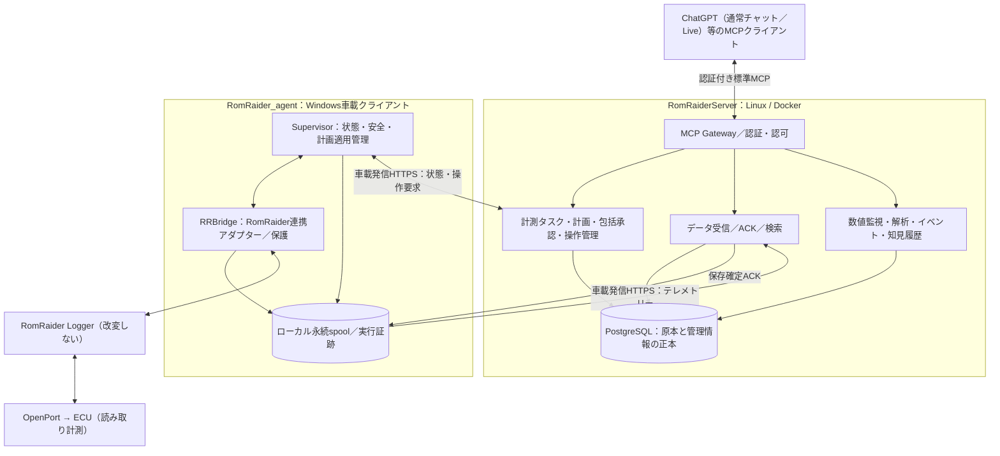

# RomLogger システム基本設計書（初稿）

| 項目 | 内容 |
| --- | --- |
| 文書ID | RLG-BD |
| 版 | 1.0.0 |
| 作成日 | 2026-10-12 |
| 状態 | **基本設計ベースライン完成（実装／実車検証前）** |
| 要件の正本 | [システム要件定義書 v1.0.0](system_requirements.md) |
| 適用対象 | RomLogger Server／車載クライアント／MCP経由のAI連携 |
| 変更対象 | 本書は設計文書。既存PoCの実装・安全ガードは変更しない |

## 1. 目的、範囲、優先順位

本書は、要件定義書 RLG-SRS v1.0.0 に対する製品の**論理アーキテクチャ、責務分界、主要処理、データ保全、安全制御、配備、開発順序**を定める。別文書の [Server–Agent外部インターフェース概要](interfaces/server_agent.md)、**[具体通信契約v1](interfaces/server_agent_wire_v1.md)**、[MCPインターフェース設計](interfaces/mcp.md)、[論理データ設計書](logical_data_model.md)、[安全・検証計画](safety_validation.md) が本書を補完する。

判断の優先順位は、承認済みSRS → 基本設計 → 外部IF契約 → 詳細設計・実装とする。基本設計内に残る技術未検証事項は承認済み要件の達成宣言ではない。

PoCは技術検証資産であり、ソース／クラス／通信形式／テーブル定義／暫定安全制限の互換維持義務はない。**要件を満たし、コスト上合理的な既存部分は再利用する**。RomRaider本体改変を前提とせず、既存RRBridge（Java Agent）をアダプターの第一候補とする。ただし、実ECU→Serverの連続したサンプル取得は未検証であり、実機検証まで確実に動作すると断定しない。

### 1.1 設計上の除外

ECUへの書込み／フラッシュ、ROM読書き、リセット、DTC消去、アクティブ制御、ファーム更新、第三者向けSaaS、常時稼働の有料LLM API、独自GUIの必須化、DBインフラのバックアップ／冗長化／物理ストレージ設計は対象外。DBの保存責任、スキーマ変更への配慮、アプリケーションからのデータ誤削除防止は対象内。

## 2. システム構成と責務（BD-001）

これは論理構成図であり、コンテナ／プロセス／スレッド数の指定ではない。Agentの内部構成も、物理分割を強制しない。

| 領域 | 責務 | 引き受けない責務 |
| --- | --- | --- |
| AI／MCPクライアント | 目的解釈、計画提案、取得データの意味付け・再評価、解析記録の登録 | ECU操作の直接実行、実車の最終安全判断、常時無人監視の保証 |
| Server | タスク・承認範囲・計画版・操作要求、デバイス認証、データ永続保存、検索、監視、解析履歴、MCP | ECUへの直接通信、車載側の安全条件の免除 |
| Supervisor | 車載状態の統括、対応項目の発見と検証、計画適用の判断、実行追跡、ローカル復旧、起動モード・手動介入の管理 | 利用者の承認範囲の拡大、サーバー原本の長期保管 |
| RRBridge | RomRaiderからのサンプル取得、認められたロガー操作、ロガー内部レベルの最終保護 | 独自のAI判断、未許可ECU制御 |
| ローカル保全／転送 | 全取得済みサンプルの永続spool、未ACK保護、再送、最新と滞留の公平な転送 | ACK前の任意削除、サーバー長期原本の代替 |

**実行権限の原則:** AIが提案しServerが承認範囲と期限を検証した場合でも、Supervisorが現車状態に基づき安全性と適用可能性を最終判断する。RRBridgeにも実行時の独立保護を置く。操作受付≠実機適用≠正常計測確認。

## 3. 動作モードとライフサイクル（BD-003）

- **手動モード:** 通常のRomRaider手動利用を妨げず、AI／Server連携を必須にしない。
- **AI連携モード:** 起動方法により選択し、サーバー／AIが利用不可でも基本計測を継続。AIの変更要求を受ける場合だけ、包括承認と車載安全検証を要求。
- モードの実行中切替は要求しない。必要なら再起動する（FR-OPS-002）。
- 計測タスク終了後は基本計測に復帰。AI連携の停止操作は独立して提供し、計測データは可能な限り保持する。
- AI連携モードでの自由な手動変更との共存を前提としない。ローカルの手動介入を検知した場合、自動変更を一時停止し、状態照合後に再開する。安全機構 ＞ ユーザーのローカル介入 ＞ AI操作要求。
- Windows側はCLI等の軽量な運用手段を基本とし、特定PCのユーザーパスに依存しない。

## 4. 論理データ構成（BD-002、004、005）

- **車両:** 計測対象の識別。ECU識別・対応情報の来歴を関連付ける。
- **車載デバイス:** 認証主体。車両との利用期間を区別する。
- **走行セッション:** 原則エンジンON～OFF。判定不能な開始・終了は推定／未確定と明示。
- **計測実行:** ロガーによる一連の取得実行。アプリ再起動は新たな計測実行になり得るが走行終了とはみなさない。
- **計測セグメント:** 適用パラメーター集合・定義版が一定の区間。切替時の非計測期間も別イベントとして明示。
- **取得イベント／サンプル原本:** 観測時点に得た値の集合、時刻、識別、取得順、プロファイル版、データ種別を追跡。
- **計測タスク:** 目的、承認範囲、状態、計画版。複数件を保持可能だが、車両あたり実行中は原則1件。同一走行に時間を分けて複数タスク、同一タスクに複数走行を関連付け可能。
- **解析・監視:** 生データを変更せず、監視条件、イベント、結論、根拠、訂正／撤回関係を永続記録。

詳細は [論理データ設計書](logical_data_model.md)。DBはPostgreSQLを採用し、取得イベント単位の柔軟な値保持を基本とする。JSONB／正規化／索引等の**物理表現は未決**。

## 5. 計測データの取得・保全（BD-002）

1. RomRaider Logger内部から、CSV記録状態に依存せず取得可能な観測値を受け取る。
2. 車載側はネットワーク送信より先に、取得イベントを再起動後も復旧可能な永続spoolへ保存する。
3. 保存済みデータを小さな単位で速やかに非同期転送する。通信断中も計測とspool保存を継続。
4. Serverは妥当性検証と重複判定を行い、**実際のDB永続保存が確定した範囲のみACK**する。
5. 車載側は確認できたデータのみ送信済みとして扱い、自動的にローカル容量を回収する。
6. ACK喪失時には再送し、同一識別子・同一内容は冪等に処理する。同一識別子で内容が異なる場合は整合性エラーとする。

配送モデルは **at-least-once + Server側冪等保存**。TCP／HTTPSの通信機構を信用し、独自トランスポート信頼性機構を増やさない。一方、TCP受信成功とDB永続化は異なるため、保存確定ACKは省略しない。

- 正常時はスプールにまとめて貯まるのを待たず送信。通常転送の鮮度を重視する。
- 長時間オフライン後は**最新値の送信と古い滞留の回収を両立**し、過去分を永久に放置しない。到着順は取得順と一致するとは限らない。
- 容量監視・事前警告・OS領域保護を設ける。未ACKデータを勝手に消さない。書込み不能時は欠落／停止／原因を可視化し、絶対無損失を約束しない。
- ACK済みspoolは自動削除可能。Server内の原本に保持期限による自動削除を設けない。
- 取得時刻と取得順序を保持し、保存・受信時刻と混同しない。必要な保存時刻は転送単位等で管理し、全サンプルに冗長な時計項目を強制しない。
- 未着、欠落確定、取得停滞、転送遅延、未計測、不明を混同しない。ECU内部の実測時刻まで保証しない。
- 取得周期は実測間隔に基づいて評価する。普遍的な固定Hz／固定項目数は保証しない。
- 合成試験サンプルと実ECUサンプルは常に識別可能にする。

**保全対象:** RomRaiderからアプリケーションが取得できた全サンプル。未取得のECU値の復元や電源断時の絶対無損失までは対象外。初版のワイヤ仕様はHTTPS/JSON、UUID識別、**バッチ全件の原子的保存とACK**を採用する。詳細な契約は[Server–Agent通信契約v1](interfaces/server_agent_wire_v1.md)を参照する。実ECUによる性能・保全の検証結果で改訂可能とする。

## 6. AI計測タスク・計画・プロファイル（BD-004）

- AIがServerの対応パラメーター情報、過去データ、取得品質をMCPで参照し、目的・選択項目・要求品質・理由を表現する**宣言的な計測計画**を提案する。
- Serverは計測タスク、**タスク単位の包括承認**、有効範囲と期間、計画版、操作要求の受付／期限／結果を管理する。承認範囲外の変更は許可しない。
- 車載側がRomRaider定義と接続ECU情報を発見し、定義上の候補／適合可能性／実取得確認を分けてServerへ同期する。AIは同期情報のみを取得確認済みとみなす。
- 原則として、**Serverは宣言的な計画を管理・事前照合し、車載側が実機定義から最終RomRaiderプロファイルを生成・検証**する。Server生成方式は比較候補として残す。具体的なファイル形式をここでは強制しない。
- AIは基本項目を含む全計測項目を調整できる。安全判定の入力がAI選択項目から欠落したら、独立した信頼可能な情報で検証できない限り当該操作を拒否・保留する。
- 計画版、現在の実機適用状態、ユーザー介入を照合し、旧版・競合・失効要求による上書きを禁止する。
- 実測取得品質の悪化はAI不在時にも検知・記録し、局所保護／フォールバックする。AIへの能動プッシュは前提とせず、次回MCP取得時に再計画可能にする。

### 6.1 安全なプロファイル切替の論理手順

1. 計画・承認範囲・計画版・有効期限を確認。
2. Logger定義と実ECUの適合、通信負荷、現車状態、安全入力を検証。
3. 直前の正常計測構成と未送信原本の保全を確認。
4. 許可された範囲のRomRaiderロガー操作だけを実行。
5. 実取得と品質を検証。適用成功と検証成功は別の状態として記録。
6. 品質悪化時は可能なら直前の正常構成に復帰。復帰不能・判定不能なら再試行を無制限に繰り返さず、自動変更を停止して原因を記録。

切替中の欠測は許容。**切替前に取得済みのデータの消失は不可**。走行中切替は目標だが、独立安全条件と実ECUでの段階的検証を満たすまでは解禁しない。車両制御・ECU書込み系はシステムで公開しない。

## 7. 分析、継続監視、解析履歴（BD-005）

- Serverは**行（走行・時間・条件）と列（パラメーター）の指定ができる、生データ相当の検索**を提供する。任意SQL実行はMCPに公開しない。値条件・AND/OR・ソート・ページング・全量への段階的到達を可能にする。索引／クエリ構文はIF設計で決定する。
- Server側の統計（時間範囲、分布、時系列変化等）は原本を置換しない補助機能。最新値は当初PostgreSQLから参照し、専用キャッシュを初期必須としない。
- 車載側が取得・ECU接続品質を独立監視し、Serverは永続的な数値監視をLLM無しで実施。複数条件・持続時間・欠測・ノイズ・状態依存性を扱えるルールを管理する。
- イベントには時刻・原因／条件・重要度・根拠範囲・対応／確認状態を関連付ける。サーバー未着のみでECU停止と断定しない。
- AI解析結果は目的、対象、根拠範囲、計画版、結論、不確かさ、未解決事項と共に**追記型**で保存。訂正・補足・撤回は履歴関係として保持し、別チャットから再利用可能。
- Discord等のプッシュ通知は任意拡張。MCP経由のChatGPTの自発的呼び出し・割り込み発話を保証しない。監視は車載警報装置の代替ではない。

## 8. 外部インターフェース、認証、運用（BD-006、007）

ServerはAI向け標準MCPと、車載向けHTTPS APIを**論理的に分離**する。車載への公開着信ポートは不要とし、データ送信・状態同期・操作要求取得は車載側発信で成立させる。

| 接続／権限 | 設計方針 |
| --- | --- |
| MCP利用者 | 認証必須。参照、解析記録、監視条件、計測操作、管理操作を区別 |
| 車載デバイス | デバイス固有の認証、車両への紐付け、失効・更新が可能 |
| 管理者 | デバイス登録／秘密情報管理等の管理操作を限定 |
| 外部通信 | TLS暗号化を前提。DBをインターネットへ直接公開しない |
| 互換性 | 共通IF仕様に版を持たせ、非互換操作を拒否。基本計測・保全は可能な限り継続 |
| 可観測性 | 構造化ログ、計測・spool・転送・操作・MCPの診断状態を提供 |
| 運用環境 | Linux/Docker Server、Windows Agent。独立更新、PC固有パス禁止 |

MCP認証の具体方式はChatGPT通常チャット／Liveの実対応を検証して選定。合成データ専用の公開PoCと実車データ／実操作の本番MCPは隔離する。秘密情報をリポジトリ・ログに出さない。特定の監視製品や複雑な認証基盤は要求しない。

操作要求は非同期で配送し、受付・配送・現地実行・品質確認・結果確定を区別する。期限切れ、曖昧な再試行、重複実行、無効な承認範囲を拒否する。再接続時にはServerの期待状態と**車載側の実状態**を照合する。

## 9. 通信契約の正本・文書体系

| 文書 | 正本配置 | 役割 |
| --- | --- | --- |
| 要件定義 RLG-SRS | docs/system_requirements.md | 何を満たすか。承認済 v1.0.0 |
| 本書 RLG-BD | docs/basic_design.md | どう分担・構成するか。本初稿 |
| 外部IF概要 RLG-IF-SA | docs/interfaces/server_agent.md | Agent–Server間の意味論・境界 |
| 外部通信契約v1 RLG-IF-SA-WIRE | docs/interfaces/server_agent_wire_v1.md、docs/interfaces/agent_api_v1.openapi.json | HTTP/JSON・認証・ID・原子的ACK・エラー、OpenAPI形式の契約 |\n| 論理データ設計 RLG-LDM | docs/logical_data_model.md | 保存・検索単位、エンティティ関連 |
| MCPインターフェース RLG-IF-MCP | docs/interfaces/mcp.md | ツール契約と列・行・複合検索、権限 |\n| 車載安全・検証 RLG-SAFETY-VAL | docs/safety_validation.md | ローカル安全ゲート、フォールバック、実機検証条件 |\n| 要件対応 RLG-TRACE | docs/requirements_traceability.md | SRS全IDと設計・検証観点の対応 |\n| 詳細設計 RLG-DD | docs/server_detailed_design.md、docs/database_detailed_design.md、docs/agent_detailed_design.md、docs/mcp_detailed_design.md、docs/operations_detailed_design.md | Server／DB／Agent／MCP／運用の実装前詳細仕様 |\n| 試験計画 RLG-DD-TEST | docs/test_acceptance_plan.md | 契約・実ECU・MCP・各開発段階の受入条件 |\n| 設計判断台帳 RLG-ADR | docs/design_decisions.md | 合意済み／委任判断／技術検証待ちの分類 |
| PoC接続規約 | RomRaider_agent/docs/10_interfaces.md | **現行PoC専用**の実装上の正本。製品IFと混同しない |

Server側の文書を製品全体の正本とし、Agent側はリンクで参照。実装の分岐時にはPoC規約と新製品規約の適用範囲を明示する。

## 10. 段階的な開発と検証（BD-008）

1. **設計:** 本書、論理データ、Agent–Server IF、MCP IF、要件対応・未検証事項を文書化しレビュー確定。
2. **Server最小基盤:** PostgreSQL、受信、保存確定ACK、冪等、検索。合成データで保存・断線再送・重複を検証。
3. **RRBridge整備:** 既存Java Agentの流用を優先し、必要に応じて取得・spool・転送を改修。高度Supervisorは後回し。
4. **実ECU結合:** 停車状態で ECU → RomRaider → RRBridge → spool → Server DB の実サンプルを検証。合成selftestを代替としない。
5. **MCP参照:** 認証、最新状態、パラメーター、生データ・品質・統計の読み取り系を優先し、ChatGPT通常／Liveで確認。
6. **Supervisorと操作系:** 能力発見、計画、承認、プロファイル生成、最終安全判定、状態照合、MCPからの計画受付。
7. **高度分析:** 数値監視・監視ルール、履歴、AI再計画、任意通知、条件を満たす走行中切替の段階的検証。

各段階の完成は「その段階の検証が終わった」ことを意味し、製品全要件の達成宣言ではない。安全操作・保全に必要な最低機能は該当段階から実装する。

## 11. 要件対応の章マッピング

| SRS | 設計の主対応箇所 | 残る確認 |
| --- | --- | --- |
| FR-OPS-001〜007 | §3、§6 | 起動・停止の具体IF |
| FR-CAP-001〜007 | §6 | Logger定義／実ECU対応検証 |
| FR-PLAN-001〜012 | §6、§8、MCP IF | 計画／承認契約、Live再呼び出しの制約 |
| FR-SAFE-001〜013 | §6 | 走行中ガード、負荷、独立入力の安全検証 |
| FR-DATA-001〜010 | §4、§5 | 原本の同一性、スプール耐障害性、ACK |
| FR-RES-001〜008 | §3、§5、§6、§8 | 再接続・再起動整合 |
| FR-SESSION-001〜004 | §4 | エンジンON/OFF判別 |
| FR-MCP-001〜009 | §7、§8 | 認証互換、MCP詳細契約 |
| FR-ANL-001〜007 | §5、§7 | 列行条件の具体検索表現 |
| FR-HIST-001〜006 | §7 | 解析結果の改訂／根拠参照モデル |
| FR-MON-001〜009 | §7 | 評価器と誤検知基準 |
| FR-SEC-001〜009 | §8 | OAuth等の採否・権限粒度 |
| NFR-001〜012 | §1〜§10 | 観測性能、公開ライセンス、導入互換 |
| VAL-001〜006 | §10、§12 | 段階的な試験結果の蓄積 |

本表は**対応予定の章**であり、各要件の実装完了判定ではない。詳細設計前に個別ID単位の最終トレーサビリティを確認する。

## 12. 未決事項・検証依存（OPEN）

| ID | 未決の具体論点 | 決定・検証の場 |
| --- | --- | --- |
| BD-OPEN-01 | 実ECUからのサンプル取得における既存Java Agentの安定性 | 車載実機検証 |
| BD-OPEN-02 | 走行中の安全判定入力、通信負荷、許可条件 | 安全設計・停車→段階的検証 |
| BD-OPEN-03 | プロファイル形式生成、Logger定義／ECU適合判定の具体方式 | Agent詳細設計・実機検証 |
| BD-OPEN-04 | JSON数値・メタデータ・原本ハッシュの正規化、容量限界の実測 | Server–Agent v1の実装・結合試験 |
| BD-OPEN-05 | エンジンON/OFFの検知・不明境界の扱い | 論理データ／車載技術検証 |
| BD-OPEN-06 | ChatGPT通常・LiveとMCPの認証方式の整合 | MCP IF設計・動作確認 |
| BD-OPEN-07 | 監視条件の評価器、誤検知抑制、しきい値 | 詳細設計・実データによる評価 |
| BD-OPEN-08 | 容量・転送鮮度・取得周期の測定値と目標値 | 非機能実測 |
| BD-OPEN-09 | RomRaider、Java Agent等のライセンスと配布可否 | OSS調査・公開前 |
| BD-OPEN-10 | MCP検索契約、ページング／上限、解析履歴の登録契約 | MCP IF設計 |
| BD-OPEN-11 | タスクの同時性、競合・保留状態、複数デバイスの排他規則 | 計画／操作IF設計 |

## 13. 設計判断履歴

| 設計ID | 決定した原則 |
| --- | --- |
| BD-001 | ServerとAgentの責務分界、2リポジトリ、RRBridge再利用優先 |
| BD-002-01〜12 | spool先行永続化、ACK・冪等性、論理原本、PostgreSQL、柔軟検索、最新優先、DBインフラバックアップは対象外 |
| BD-003-01〜07 | 起動モード、包括承認、車載最終安全判定、切替時復旧、オフライン、能力検出、競合排除 |
| BD-004-01〜07 | 単一実行タスク、宣言的計画、車載プロファイル最終生成、計画版、AI不在時復旧、標準MCP |
| BD-005-01〜07 | 生データと統計、二層監視、条件異常、イベント、追記型知見 |
| BD-006-01〜07 | MCP／車載IF分離、認証／権限、非同期要求、状態鮮度、運用、配備 |
| BD-007-01〜07 | アダプター、能力検証、安全入力、セッション境界、手動介入、監視ルール、通信契約版 |
| BD-008 | 設計・通信規約を先に確定し、Server基盤→RRBridge→実ECU→MCP→Supervisor→高度機能で段階的に実装 |

## 14. 文書のレビュー・改訂方針

- 本稿は**会話上で確定した設計原則の整理**であり、フィールド形式、具体APIパス、保証秒数等を黙示的に確定しない。
- 未決事項は OPEN として追跡する。実装前に双方のIF契約が確定していることを優先する。
- 文書を承認しても、実車で未検証の走行中切替を許可したことにはならない。
- 新製品の実装が始まるまで既存PoCの安全制限を緩和しない。
- 詳細設計・コード変更は基本設計レビュー確定後に別工程として扱う。

## 改訂履歴

| 日付 | 版 | 変更 |
| --- | --- | --- |
| 2026-10-12 | 0.1.0 | BD-001〜008の会話合意を初稿として統合。未決／未検証事項を明示 |\n| 2026-10-12 | 0.2.0 | Server–Agent通信v1・MCP IF・安全検証・要件追跡資料との整合を更新 |\n| 2026-10-12 | **1.0.0** | Server／DB／Agent／MCP／運用・テスト詳細設計を統合し、設計ベースライン化。技術検証未完了事項は継続管理 |
