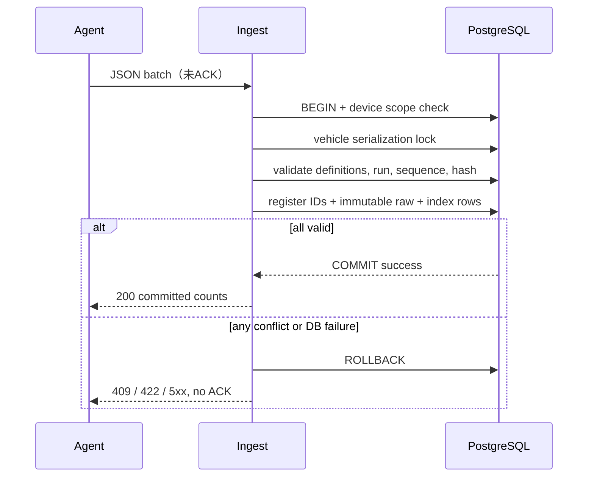

# DD-DB-001 PostgreSQL物理データ設計

| 項目 | 内容 |
| --- | --- |
| 文書ID | RLG-DD-DB |
| 版 | 1.0.0 / 2026-10-12 |
| 状態 | **設計ベースライン（DDL適用・性能実測は未実施）** |
| 上位 | [論理モデル](logical_data_model.md) / [Server詳細設計](server_detailed_design.md) / [通信v1](interfaces/server_agent_wire_v1.md) |

## 1. ストレージ選定と原本の定義

**PostgreSQL 16以上、リレーショナルメタデータ＋取得イベントごとの不変JSONB原本＋項目別検索索引テーブル**を初版の物理設計として採用する。

- `observation_records`は**1イベント＝1行**、元の値集合・元時刻・適用定義版・実測／合成・取得順・来歴の不変値を保持する。ここが取得済み原本の正本。
- `observation_values`は元イベントの各値を**同じトランザクションで派生格納する検索用射影**。正本の代替でも別解釈された値でもない。障害時は原本から再構築できる。
- `profile_revisions`と`profile_parameters`は不変の版。パラメーター名・単位が後日変わっても過去観測の解釈は変わらない。
- `vehicle`、`device`、`run`、`segment`、`drive_session`、`task`、`plan_revision`、`command`、`event`、`monitor_rule`、`analysis_record`は別のライフサイクルを持つ。
- **原本にはTTLを設定せず、定期DELETE、ローテーションによる自動破棄を禁止。** DBバックアップは別の基盤責務。

XML定義、内部SQLite、PoCのTSV／単一JSONB設計に互換を合わせない。移行する場合には来歴・実データ区別・損失記録を明示し、無理な後方補完をしない。

## 2. テーブル構成と主要カラム

以下の論理列名は設計基準。DDLの正確なSQL、数値型、長さ、パーティション／VACUUM等は実装マイグレーションで固定するが、**制約の意味は変更しない**。

| テーブル | 識別子 | 重要属性と制約 |
| --- | --- | --- |
| `vehicles` | `vehicle_id UUID PK` | display_name、created_at、archived_at |
| `devices` | `device_id UUID PK` | token_hash、token_last_rotated_at、revoked_at、agent_version、last_seen_at |
| `device_assignments` | `assignment_id UUID PK` | device_id FK、vehicle_id FK、valid_from／valid_to。現在の割当は同一Deviceで原則1件 |
| `capability_snapshots` | `snapshot_id UUID PK` | device_id／vehicle_id、reported_at、logger_version、definition_fingerprint、ecu_identity、content_hash、不変payload |
| `capability_parameters` | `snapshot_id,parameter_id PK` | name、unit、availability、evidence |
| `profile_revisions` | `profile_revision_id UUID PK` | device_id、vehicle_id、fingerprint、content_hash、created_at、immutable_payload |
| `profile_parameters` | `profile_revision_id,parameter_id PK` | name、unit、definition content |
| `measurement_runs` | `run_id UUID PK` | device_id、vehicle_id、started_at、ended_at、state、synthetic_allowed |
| `measurement_segments` | `segment_id UUID PK` | run_id FK、profile_revision_id FK、started_at、ended_at、cause、verification_state |
| `observation_records` | `record_id UUID PK` | device_id、vehicle_id、run_id、segment_id、sequence、captured_at、source_kind、profile_revision_id、values_jsonb、content_hash、ingest_seq、received_at |
| `observation_values` | `record_id,parameter_id PK` | record_id FK、profile_revision_id／parameter_id、value numeric、unit（定義へFK）、source原本を追跡 |
| `telemetry_events` | `record_id UUID PK` | kind（event／gap）、run_id、segment_id nullable、captured_at、source_kind、event_type、data_jsonb、content_hash、ingest_seq |
| `drive_sessions` | `drive_session_id UUID PK` | vehicle_id、started_at／ended_at nullable、start_confidence、end_confidence、boundary_evidence |
| `drive_run_links` | `drive_session_id,run_id,relation_version PK` | 有効時間範囲、推定／確定フラグ |
| `tasks` | `task_id UUID PK` | vehicle_id、purpose、state、created_by、created_at／completed_at |
| `task_plan_revisions` | `plan_revision_id UUID PK` | task_id、revision_number、capability_snapshot_id、plan_jsonb、content_hash、created_at |
| `approval_scopes` | `approval_scope_id UUID PK` | task_id、vehicle_id、approved_by、scope_jsonb、starts_at、expires_at、revoked_at |
| `task_executions` | `execution_id UUID PK` | task_id、plan_revision_id、vehicle_id、run_id nullable、active_range、state |
| `command_requests` | `command_id UUID PK` | vehicle_id、device_id、task_id、plan_revision_id、approval_scope_id、action、immutable_body、issued_at、expires_at、status、lease_until、expected_profile_revision_id |
| `command_reports` | `report_id UUID PK` | command_id FK、device_id、state、observed_profile_revision_id、reported_at、server_received_at、content_hash |
| `operation_events` | `operation_event_id UUID PK` | command_id nullable、actor、state、occurred_at、content_jsonb |
| `monitor_rules` | `rule_id,revision PK` | vehicle_id、expr_jsonb、required_definitions、enabled、owner |
| `monitor_events` | `event_id UUID PK` | rule_id/revision、vehicle_id、source_observation_range、state、occurred_at、acknowledged_at |
| `monitor_cursors` | `rule_id/revision,vehicle_id PK` | last_ingest_seq、last_evaluated_at、state_blob |
| `analysis_records` | `analysis_id UUID PK` | vehicle_id、task_id nullable、evidence_jsonb、conclusion、certainty、created_at、creator |
| `analysis_relations` | `relation_id UUID PK` | source_analysis_id、target_analysis_id、relation_type、created_at |

**監査:** トークンは原則別 `device_credentials` テーブルで複数世代・失効を管理し、hash以外の平文を保存しない。初回の登録・車両割当の認可と記録も必要。管理者認証・MCP利用者IDは、車載tokenと別の資格情報ドメイン。

## 3. 主要制約・整合性

- `observation_records (run_id, sequence)` はUNIQUE。サンプルの後着・送信順変更を許可し、重複して同じsequenceに異なるrecord_idが割当たれば409。
- `record_id`は観測、イベント、gapの**種類を跨いでも再使用禁止**。実装では共通 `telemetry_record_registry(record_id PK,kind,content_hash,run_id,ingest_seq)` を設け、1transaction内で原本テーブルとの登録を一体化する（観測・イベント横断の衝突抑止）。
- `profile_revisions`を更新しない。登録時に`content_hash`比較し、別内容同一IDは409。FK参照先のあるprofileは削除しない。
- `observation_values`は同じprofile_revisionの`profile_parameters`に定義されたparameterのみとし、1イベント内の同一parameter重複を禁止。
- データ受信バッチ内の`record_id`重複は422。バッチの一部だけcommitしたままcommitted応答を返さない。
- `measurement_runs.device_id/vehicle_id`、`segments.run_id`、観測のdevice/vehicle/run/segment/profile関係の**複合整合性**をトランザクション内で検証する。FKだけで漏れる範囲はアプリとDB制約を併用。
- タスク実行中1車両最大1件は、PostgreSQLの**partial unique index**（車両ID、state=active）または同一トランザクション中の排他ロックで担保。両方を補助的に利用可能。
- 命令配信と状態報告には版番号等の楽観的排他を使用。失効済み／取消済みcommandが再度activeに戻らない。
- `DriveSession`の未確定境界にはNULLとconfidenceを許し、RomRaider再起動だけでセッションを強制終了しない。
- 解析結果は論理的に追記のみ。撤回・訂正・関係は`analysis_relations`で表現し、元をDELETEしない。

## 4. 実装設計の参考SQL（**マイグレーション未適用**）

以下は主要な制約イメージであり、そのまま投入できるDDL一式ではない。

```sql
-- 要点：同じrunに異なる観測IDで同じsequenceを割り当てない
CREATE UNIQUE INDEX uq_observation_run_seq
  ON observation_records (run_id, sequence);

-- パラメーター版は不変、集合内の同名ID重複不可
ALTER TABLE profile_parameters
  ADD CONSTRAINT pk_profile_parameter
  PRIMARY KEY (profile_revision_id, parameter_id);

-- 観測一件の値の二重書込防止
ALTER TABLE observation_values
  ADD CONSTRAINT pk_observation_value
  PRIMARY KEY (record_id, parameter_id);

-- タスクの同時実行を車両あたり原則1件に限定
CREATE UNIQUE INDEX uq_active_task_per_vehicle
  ON task_executions(vehicle_id) WHERE state = 'active';

-- 検索用の代表的な索引
CREATE INDEX ix_obs_vehicle_time
  ON observation_records(vehicle_id, captured_at, record_id);
CREATE INDEX ix_obs_run_seq
  ON observation_records(run_id, sequence);
CREATE INDEX ix_obs_ingest
  ON observation_records(vehicle_id, ingest_seq);
CREATE INDEX ix_values_param_value
  ON observation_values(parameter_id, value, record_id);

-- 監視イベントの冪等キーは監視ルール・revision・入力境界で構成
-- 具体的なUNIQUE制約はイベント窓の表現を決めてから確定する。
```

**重要:** `CREATE UNIQUE INDEX uq_observation_run_seq`とDB内の定義変更・索引作成の順序、既存テーブル有無等はAlembicのマイグレーションで正しく管理する。

## 5. JSONB原本と検索用値の整合

- ServerはJSON受信後、**正規化した取得イベント**を`observation_records`へ保存し、同じDB transaction中に`observation_values`を展開する。
- どちらかの保存が失敗したら全体をロールバックし、ACKしない。
- 将来の検索インデックスの再生成・物理構成変更で、`observation_records`の元イベント・時刻・定義版・内容ハッシュを変更しない。
- 値の単位はprofile revisionに固定された定義から解釈する。元の`unit`を欠落させないようプロファイル側のスナップショットは永続保持。
- 数値は有限数。NaN/Infを無理に0へ変えない。値が来ない場合は当該パラメーターを観測値集合から外し、品質イベントやmissing_reasonを追跡する。
- データ型の正本は元RomRaiderが公開した計測値。ECUバイナリの原本保証ではない。

## 6. 順序・スナップショット境界の厳密性

**要注意:** PostgreSQL `BIGSERIAL` 等の増分採番はトランザクションcommit順とは一致しない。単純に「MAX(ingest_seq)以下は検索スナップショットに含める」とすると、並列トランザクションが後からcommitして、ページ境界より前に突然現れる可能性がある。

初版は**車両単位の取り込み順を直列化**することでこの問題を回避する。

1. 書込みバッチは1車両に限定し、commit直前まで`pg_advisory_xact_lock(vehicle_idから決定的に導いたキー)`を保持する。
2. そのロックを保持してDB内の`ingest_seq`を割り振り、同じtransactionでcommitする。次の同車両書込みはロック解放後に開始する。これにより**同一車両に限り**取り込み順＝commit可視化順が保証される。
3. MCPの新規検索カーソル作成時、同じ車両ロックをトランザクションで取得後、**現時点でcommit済みの最大ingest_seq**を取得し、その境界をカーソルに固定してからロックを解放する。
4. 後続ページは`ingest_seq <= snapshot_watermark`で絞り、時刻が古いサンプルの後着が混入しない。
5. 長時間のDB transaction／MVCC snapshotをページを跨いで保持しない。カーソルの検索条件／閲覧認可／最終キー／有効期限を署名して改ざん防止。

ロックの粒度は**車両ごと**なので個人用途では十分軽量と予想されるが、推測にとどめ、並列負荷試験で確認する。異常時にglobal lockで処理が滞留する場合は、Server側のcommit-boundaryレジャーや履歴版スナップショットへ設計変更する。異なる車両を1クエリで結合する機能は初版のMCP契約対象外。

**ロックキー衝突:** 64bit advisory keyはUUIDをハッシュ化するため理論上衝突し得るが、衝突は余分な直列化になるだけで誤データの混入を生まない。全Serverインスタンスが同一DB上で同じ鍵導出規則を共有すること。簡易な`vehicles`行ロックで同じ契約を実現してもよい。

## 7. バッチの原子性・永続ACK



- 同一record_id・同一内容は冪等にduplicate。異なる内容や異なるkindへの再利用は409。
- 同batch内の不正が他recordを巻き込んで**永続化成功扱い**にならないよう、検証失敗時は全件ロールバック。
- Clientは保存確定応答のbatch_id、件数一致、status=committedを確認してから該当record_idをACK済みとする。
- 複数Serverコンテナで受信しても、**同じPostgreSQLの一意制約とtransaction**によって収束する。
- DBのチェックポイント・WAL／fsyncの耐久性は正しく設定されたPostgreSQLを前提とし、`synchronous_commit=off`のような耐久性を失う設定は使用しない。

## 8. 時系列検索・性能

### 8.1 検索アルゴリズム

1. vehicleの閲覧権限を確定。
2. `capture time, run, segment, task_execution, profile_revision`で範囲を選定。
3. `observation_values`を使ったEXISTS／NOT EXISTS等でパラメーター条件ASTをSQLへコンパイル（SQLインジェクション不可なプレースホルダ使用）。
4. 出力列は必要なパラメーターに限定し、欠測は`missing_reason`付きnull。存在しない値を0で補間しない。
5. captured_at, run_id, sequence, record_idの安定なソート＋キーセットカーソルを使う。
6. ingest watermarkで後着データのページ横断混入を防ぐ。
7. max rows、bytes、実行時間、AST複雑度でサービスを保護。全件アクセスはcursorで分割。

### 8.2 パーティション

初版は**通常テーブル＋必要な索引**を選択。計測規模で肥大化が問題化したら、`captured_at`月次等のパーティションを検討。ただし**TTL削除は禁止**。PostgreSQLのパーティションテーブルのUNIQUE要件とrecord_idグローバル一意性には設計上の制約があるため、分割する場合もregistryのグローバル一意を維持する。再配置・後着データ・データ移行をテストしてから採用する。

### 8.3 同一runの前後検索

「既知の観測Aの次を取る」には`record_id`でObservationの`run_id`、`sequence`を解決し、索引`(run_id,sequence)`を利用する。`where.is_present(parameter_id)`は`observation_values`への`EXISTS`で判定する。afterは`sequence > A.sequence`を昇順、beforeは`sequence < A.sequence`を降順に上限N件抽出して昇順に整列する。

- 別runへは自動的に越境しない。観測Aの車両スコープ／runの整合性を認可後に確認する。
- プロファイル変更により当該パラメーターを取得していない観測は`is_present`で選択から除外可能。単なる値0の行は除外しない。
- 過去データが後着しても、初回検索のcommit済み`ingest watermark`をカーソルに束縛し、既存ページへ割り込まない。
- 前後検索にも通常の行数／バイト上限、ページング、単位／定義版・欠測とデータ品質の扱いを適用する。

## 9. データ保全・監査・運用

- 物理バックアップと復元はインフラ側へ委譲。アプリは破壊的な自動削除を行わず、マイグレーションを適用可能な形で記録する。
- 不変原本／プロフィール／履歴／認可証跡は、運用API経由の任意削除を初版提供しない。データ保護法や明示的な所有者の削除要件が生じれば別設計。
- Device認証は平文tokenではなく一方向hashで照合。権限／車両割当はDB上で独立に管理。
- DB接続利用量、処理時間、deadlock／ロック待ち、index hit、WAL容量、未処理ルール、監視イベント数を計測可能にする。
- 開発／本番で秘密情報をSQL migrationやGitリポジトリへ含めない。

## 10. 検証

| ID | チェック |
| --- | --- |
| DB-01 | raw eventと検索用値が同時commitまたは同時rollback |
| DB-02 | 同じrecord_id同じ内容で重複増加なし、別内容で409 |
| DB-03 | 異なるrecord_id同run+seqの衝突で409 |
| DB-04 | 観測・event・gapのrecord ID跨ぎ衝突が拒否される |
| DB-05 | profile定義欠落・単位版違いで誤ったACK／検索結果を出さない |
| DB-06 | 2つの並列受信がcommit順とカーソル境界を破壊しない |
| DB-07 | 後から古い観測時刻のデータが届いても、既存cursorの結果が変わらない |
| DB-08 | Task activeを2件同時にしようとするとDBで片方が拒否 |
| DB-09 | 車両またぎの資格情報で他車両の検索・保存ができない |
| DB-10 | ロールバック／再送／再起動で元の観測値・定義版が保持される |
| DB-11 | 大量行・列条件・ページングに索引が使用される（EXPLAIN） |
| DB-12 | 過去原本／分析履歴にTTL削除が設定されていない |

## 11. 実装前の補足判断

本書により基本的なテーブル構成と不変・冪等性・検索の設計を定めた。実際のDDL／ORM型、DBマイグレーション、floatとnumericの正規化アルゴリズム、ウォーターマーク取得の性能は**実装時にテストして確定**する。ここで決めた安全性や原本保証を後退させる変更はレビュー対象。
