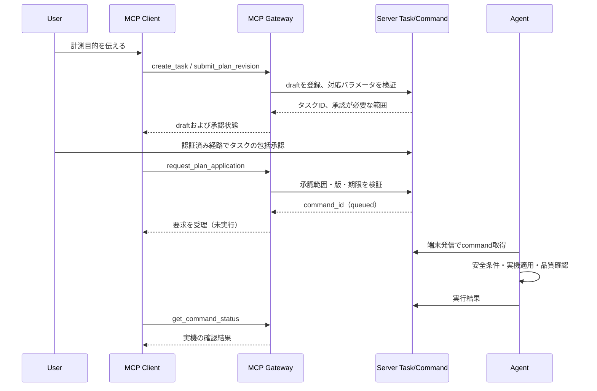

# RomLogger MCPインターフェース基本設計・ツール契約

| 項目 | 内容 |
| --- | --- |
| 文書ID | RLG-IF-MCP |
| 版 | 0.1.0 / 2026-10-12 |
| 状態 | 設計選択を記載したドラフト。ChatGPT通常チャット／Live接続・認証は未検証 |
| 上位文書 | [要件](../system_requirements.md) / [基本設計](../basic_design.md) / [論理データ](../logical_data_model.md) |
| 対象 | 認証済みリモートMCP。Server内部APIやAgentの通信契約とは分離 |

## 1. 基本方針

1. **標準MCP**で公開し、特定AIモデルのプロンプト形式やLLM常駐に依存しない。
2. ChatGPT通常チャット・Liveは初期検証対象。他MCPクライアントは互換を目指すが、継続的呼び出しや音声発話の保証はしない。
3. 車載・ECUの安全判定はMCPの外。MCPの計画登録成功と実機反映成功は別。
4. 計測・解析の主体はユーザーの会話。Serverの数値監視はLLM非依存で続き、異常は次回のMCP取得時に参照できる。
5. **生データ全量への到達性**を保証する。統計結果だけに制限しない。データを暗黙に間引かない。
6. 任意SQL、任意ファイル／OSコマンド、ECU制御、ROM書込み・リセット・DTC消去のMCPツールを公開しない。
7. 本番MCPは実車データへの匿名アクセスを許さない。PoCの合成データ専用公開エンドポイントは本番の認証・データから隔離。

## 2. 接続・認証・認可

- リモートMCP用のHTTPSエンドポイントはServer側に設ける（案: `/mcp`）。車載API `/api/agent/v1/`とは認証主体・トークン・権限を分離する。
- ChatGPTとMCPの実際の接続方法を確かめた上で、**クライアント対応の標準的認可方式**を選定する。OAuth系を優先比較するが、現時点でChatGPT Liveとの本番互換を検証済みと表記しない。
- 役割を `reader`（参照）、`analyst`（解析結果記録・監視ルール操作）、`planner`（タスクと計画の提出）、`admin`（車載端末の登録や承認管理）として論理分離。個人運用で複雑なテナント管理は不要。各ツールの呼出しで車両のスコープを検証する。
- 計測タスクの**包括承認**は、AIの自然言語上の断言だけでは有効化しない。Serverで利用者が承認範囲を認証済みの手段（CLI等、もしくは十分検証した対話承認経路）で確認し、承認IDと有効範囲を保存する。承認済み範囲内の計画改訂には毎回再承認不要。
- ツールが返すのは必要な業務データのみ。トークン、DB接続情報、内部パス、SQL、他の車載端末の秘密を露出しない。
- 管理者の高権限操作はMCPへ無制限公開しない。初版は管理CLIを基本とする。

## 3. ツールカテゴリと初期ツール名案

名前は**MCPツールとして固定する設計案**。一部フィールドの詳細JSON Schemaは実装前にスキーマファイルへ起こし、同じ変更で本文を更新する。

| ツール名 | 種別・必要権限 | 入力の中心 | 出力の中心 |
| --- | --- | --- | --- |
| `list_vehicles` | 参照 / reader | 任意の状態条件 | 権限内の車両ID・名称 |
| `get_vehicle_status` | 参照 / reader | vehicle_id | 最終受信状態・鮮度・ECU/Logger状態・実測品質 |
| `list_parameters` | 参照 / reader | vehicle_id、ecu、availability、definition_version | Logger候補、ECU適合、実取得確認、単位、根拠 |
| `list_drive_sessions` | 参照 / reader | vehicle_id、時間範囲、cursor | 走行ID、境界の確度 |
| `list_measurement_runs` | 参照 / reader | vehicle_id、session_id、時間範囲 | 計測実行・セグメント・プロファイル版 |
| `query_telemetry` | 参照 / reader | **行・列・条件・ソート・ページ** | 生サンプル、欠測・品質、next_cursor |
| `get_telemetry_stats` | 参照 / reader | queryと同じ対象範囲／対象列 | 集計値＋品質上の制約 |
| `list_events` | 参照 / reader | vehicle_id、時刻、重大度、unread、cursor | 監視・取得・操作イベント |
| `list_tasks` / `get_task` | 参照 / reader | vehicle_id、task_id | タスク、計画版、承認・適用状態 |
| `create_task` | 更新 / planner | vehicle_id、目的、計測条件 | draftタスクID、承認必要範囲 |
| `submit_plan_revision` | 更新 / planner | task_id、基準版、選択項目、品質目標、理由 | 計画版、validation、承認照合・登録状態 |
| `request_plan_application` | 更新 / planner | task_id、plan_revision_id、approval_scope_id、期限 | **command_idと受付状態**。車載適用済みを意味しない |
| `get_command_status` | 参照 / reader | command_id | Server受付／配送／車載確認／正常取得確認 |
| `list_analysis_records` | 参照 / reader | vehicle_id、task_id、status、cursor | 蓄積された根拠つき解析・訂正関係 |
| `save_analysis_record` | 更新 / analyst | 対象ID、根拠、推測程度、結論、補足／撤回対象 | 永続登録IDと成功／失敗 |
| `list_monitor_rules` | 参照 / reader | vehicle_id | 監視ルールと現在の版・有効性 |
| `upsert_monitor_rule` | 更新 / analyst | vehicle_id、rule_id、base_revision、宣言的条件 | rule_id、版、validation結果 |

「分析結果を保存する」MCPツールをAIが**必ず呼ぶ**とは保証しない。未登録の結論を保存済みと誤認させない。初版実装では参照系（list/get/query）から作り、書込み系は後続工程で追加してよい。

## 4. `query_telemetry`：SQLに近い柔軟性と安全な制限

### 4.1 リクエスト（設計案）

```json
{
  "vehicle_id": "6f58c2f3-b65d-40a1-8e54-f5eff9b02c23",
  "scope": {
    "drive_session_ids": [],
    "run_ids": [],
    "segment_ids": [],
    "task_ids": [],
    "from": "2026-10-12T10:00:00Z",
    "to": "2026-10-12T10:01:00Z"
  },
  "select": {
    "parameter_ids": ["P8", "P13", "P25"],
    "metadata_fields": ["captured_at", "sequence", "run_id", "segment_id", "profile_revision_id", "source_kind"]
  },
  "where": {
    "and": [
      {"field": "P8", "op": "gte", "value": 3000},
      {"or": [
        {"field": "P13", "op": "gte", "value": 50},
        {"field": "P25", "op": "gte", "value": 100}
      ]}
    ]
  },
  "order": {"by": "captured_at", "direction": "asc"},
  "limit": 1000,
  "cursor": null
}
```

具体ID・値は説明用。**スコープはServerが認可した車両内**でのみ検索し、raw SQLや任意の内部列名を受け入れない。

### 4.2 検索の意味

| 要素 | 契約 |
| --- | --- |
| 行の範囲 | vehicle必須。走行／run／segment／task／時間を複合指定。空配列は「該当制限なし」を意味する |
| 列 | 選択したparameter_idを応答列に展開。計測区間で存在しない列はnull＋欠測種別を返す |
| 条件AST | `and`、`or`（ネスト上限あり）、比較 `eq,ne,lt,lte,gt,gte,between,in`（許可されたデータ型だけ） |
| 値の単位 | 比較条件は**指定したparameter定義版の単位**と照合し、異単位を暗黙比較しない。同一IDで版により定義・単位が異なる場合、定義版の指定か明示的な換算指定が必要 |
| 行単位 | 1取得イベント＝1行を基本とし、選択したパラメーターが無い観測も、scopeとwhereに応じ正しく評価 |
| 同時計測 | 同じ取得イベントの値の集合であり、ECU内部で厳密に同時測定した保証ではない |
| ソート | captured_at+安定record_id等の複合タイブレークで一意に順序を決める |
| ページング | opaque cursor。条件と認可主体と検索スナップショットに紐付け、変更不可 |
| 大規模結果 | ページの継続取得で生データ全量へ到達可能。勝手なダウンサンプリング不可 |
| 欠落・加工 | 非測定、欠落、未着、合成試験、補間・要約値を識別可能。原本結果を加工して置換しない |

### 4.3 応答（設計案）

```json
{
  "columns": ["captured_at", "record_id", "P8", "P13", "P25"],
  "rows": [
    {
      "captured_at": "2026-10-12T10:00:01.234Z",
      "record_id": "6bdac9f6-d60c-4ee4-afc5-7819dab71fe3",
      "values": {"P8": 2840.0, "P13": 18.4, "P25": null},
      "missing_reason": {"P25": "not_measured"},
      "source_kind": "ecu",
      "run_id": "7ea6c054-1197-4cb6-9439-ee48275646c3",
      "segment_id": "27904521-fd3a-43e6-86de-4a76b89dfa0c"
    }
  ],
  "returned": 1,
  "limit": 1000,
  "next_cursor": null,
  "truncated": false,
  "snapshot_reference": "opaque-db-horizon",
  "quality": {"time_sync": "unknown", "contains_synthetic": false}
}
```

例の数値とwhere条件は相互に一致しない説明用としてしまうと誤解するため、実装時の契約例では**対象行を条件に合致させてからfixture化**する。上の行は**構造説明だけ**であり、whereの3000rpm条件に一致しない点に注意。

### 4.4 リソース保護とページング

- 既定1000行、1回の最大5000行を**初期設計値**とする（応答バイト上限も設定）。ページングは上限に達しても続けられる。
- 同一クエリの各ページを矛盾なく辿るため、最初の検索時点のDB確定上限（スナップショット境界）をカーソルに埋め込む。後から届いた古い時刻のレコードは次の新規検索で確認する。
- cursorにユーザー認証・車両・フィルター・並び順・上限などを束縛して署名またはServer管理する。クライアントは文字列を解釈しない。カーソルの有効期限は設定で指定。
- 条件構造の深さ、項目数、値リスト長、検索時間を制限してDoSやMCP巨大レスポンスを防止。
- 検索中のデータ遅延・未着を「データが不存在」と断定しない。検索境界、Server確定時点、品質状態を応答する。
- MCPが転送可能なデータ量にはホスト側制約がある。全量取得は**ページを繰り返してアクセスできること**を意味し、AIが1呼出しで無制限に取り込めることではない。

## 5. 統計・イベント・解析履歴のモデル

- `get_telemetry_stats` は、選択した行／列に対するmin/max/mean、件数、取得間隔分布、欠落／合成混在等を返す。原本は変更しない。
- `list_events` は未確認重大イベントを優先して検索できる。会話開始時に自動ツール呼出しされる保証はない。
- `save_analysis_record` は任意の文章に加え、**対象車両／Task／run／時間区間／参照元データ（検索条件・snapshot_reference等）／結論の確信度／既存解析への関係**を受ける。追加・訂正・撤回は新規レコードで管理し、元レコードを消さない。
- `upsert_monitor_rule` は任意プログラム実行を禁止し、専用の制限された式ASTで監視条件を保存。以後はLLMを使わずServerが評価。ルールの対象にデータがない場合は「判定不能」とする。
- 数値的異常を故障診断と断定しない。運転者の安全を妨げる危険運転指示やECU制御操作につなげない。

## 6. MCPの操作要求・承認境界



タスク単位の承認によって毎回の個別確認は不要にする。一方、承認を要求している状態と承認済み状態を区別。AIのMCP発話やツール実行だけで安全チェックを迂回させない。

## 7. 成功・失敗・境界

| 分類 | クライアントへ返す情報 |
| --- | --- |
| 認証不足 | 認可範囲外のデータや存在情報を露出しない。安全なエラー |
| ツール引数不正 | 項目・理由を返す。SQLやスタック情報を公開しない |
| 結果巨大 | 件数／打切り／cursor／取得可能な残りを示す |
| 未確認能力 | 未検証として返し、取得可能と捏造しない |
| plan登録成功 | 計画の版と承認・適用状態を返す。車載適用完了とは別 |
| 車載未接続 | 最終報告日時とstale状態を返し、現車状態を断定しない |
| 実機操作結果不明 | unknownとして返し、成功と表示しない |
| 合成データ | syntheticと明示 |
| 解析登録失敗 | 永続保存されていないことを明示し、再試行可否を返す |

## 8. 実装順序と未検証事項

**第1段階（MCP読み取り系）:** list_vehicles、get_vehicle_status、list_parameters、list_drive_sessions、list_measurement_runs、query_telemetry、get_telemetry_stats、list_events。サーバー基盤と実ECU転送が確認された後に接続試験する。

**第2段階（計画／履歴／監視）:** タスク・計画・操作結果、分析履歴、監視条件の読み書き。Server／Agentの操作IFと車載安全監督が成立した範囲で順次追加。

**外部検証に依存:** ChatGPT通常チャット／Liveにおける本番認証の実対応、同一対話中の連続ツール呼出し、分析結果の保存ツール呼出し、能動起動の可否、レスポンスサイズの上限。いずれも現段階で保証しない。SRSの目標と必須制約を維持する。

## 改訂履歴

| 日付 | 版 | 内容 |
| --- | --- | --- |
| 2026-10-12 | 0.1.0 | MCPツール一覧、SQL同等の列行・複合条件検索、認可境界、ライブ制約を初稿として規定 |
