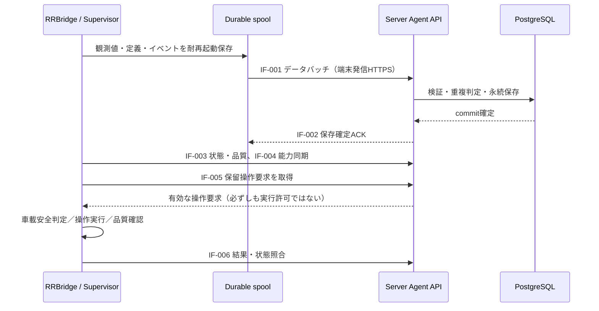

# RomLogger Server–Agent 外部インターフェース設計書（初稿）

| 項目 | 内容 |
| --- | --- |
| 文書ID | RLG-IF-SA |
| 版 | 0.1.0 |
| 作成日 | 2026-10-12 |
| 状態 | **初稿／通信契約レビュー中。API・JSON例は提案段階** |
| 上位設計 | [基本設計書](../basic_design.md)、[論理データ設計](../logical_data_model.md) |
| 正本 | RomRaiderServer/docs/interfaces/server_agent.md |
| 現PoC接続規約 | [RomRaider_agent/docs/10_interfaces.md](https://github.com/zawa356/RomRaider_agent/blob/main/docs/10_interfaces.md)（別世代・そのまま互換とはみなさない） |

## 0. 読み方と拘束力

本書はServerとAgentを**独立に開発できる通信契約**を先行して設計するもの。設計原則は会話で合意済みだが、具体的なワイヤ形式、URI、認証方式、バッチ処理単位などには未決事項がある。未決事項を既成事実化せず、IF-OPENで明示する。

- **確定原則:** 車載発信の認証付き暗号化通信、ローカル永続化後に転送、Server側永続保存後のみACK、未ACK保持と再送、冪等性、最新優先と滞留回収、非同期・期限付き操作、Serverと実機の状態照合。
- **今回の提案:** JSONでの例示、原子的バッチACK、共通ID構成、論理IF種別。これらの**具体的表現は未承認**。
- **詳細設計へ保留:** URI名・HTTPメソッド、各フィールドのJSON Schema、ペイロード上限値、タイムアウト・再試行の秒数、物理DB列、ライブラリ。

## 1. 接続とトラスト境界



車載からServerへのアウトバウンド接続だけで成立させ、インターネットから車載PCへの着信待受を必須としない。Server側の外部公開範囲は車載APIと、別に設計するMCP。DBやRomRaider内部IFを直接外部公開しない。

## 2. IF一覧

| ID | 意味 | 送信者 → 受信者 | 主な更新対象 | 初期実装 |
| --- | --- | --- | --- | --- |
| IF-001 | 計測データ・イベント転送 | Agent → Server | 観測イベント、観測値、必要な定義 | 第1段階 |
| IF-002 | 保存確定ACK・重複結果 | Server → Agent（IF-001応答） | 車載送信済み状態 | 第1段階 |
| IF-003 | デバイス・計測・品質状態報告 | Agent → Server | 現在状態、鮮度、診断情報 | 初期に最小版 |
| IF-004 | ECU・Logger能力情報の同期 | Agent → Server | 定義版、可用性、確認根拠 | Supervisor段階 |
| IF-005 | 計測計画・操作要求の取得 | Agent → Server → Agent | 要求配送、失効・競合状態 | Supervisor段階 |
| IF-006 | 操作結果・再接続時の状態照合 | Agent ↔ Server | 適用事実、検証結果、保留要求 | Supervisor段階 |
| IF-007 | 共通契約：ID／版／認証／エラー | 双方向 | すべてのIFで共通 | 第1段階から |

番号は**論理IF識別子**。HTTPエンドポイントの個数を確定するものではない。第1段階とは「Server受信基盤」実装段階を指し、ECU実機検証の前に合成入力を扱えることを意味する。

## 3. IF-007 共通規約

### 3.1 メッセージ共通情報

少なくとも次の概念をすべての該当操作・データで追跡可能とする。

| 共通要素 | 意味 | 必要性 |
| --- | --- | --- |
| contract_version | 通信契約の版 | 互換性判断・非互換拒否 |
| device_id | 接続を認証される端末ID | 接続主体の区別 |
| vehicle_id | 対象車両ID | 複数車両の混同防止 |
| request_id / batch_id | 個々の要求・送信単位の識別 | 再試行・照合・監査 |
| record_id | サンプルまたはイベントの不変な原本ID | 冪等・誤上書き防止 |
| measurement_run_id | ロガー取得実行のID | 再起動・時系列境界 |
| segment_id | 有効な取得定義の区間 | プロファイル追跡 |
| plan_revision | 計測計画の版（操作時） | 旧版誤適用防止 |
| captured_at | 車載側の観測時刻 | 解析の時刻基準 |
| reported_at / received_at | 状態報告またはServer受信時刻 | 情報鮮度と転送遅延 |
| source_kind | 実ECU／合成試験の区別 | 解析上の混同防止 |

各IFが共通情報を毎回すべて重複送信することを意味しない。認証情報や既知の接続コンテキストを用いて省略できるが、後からServerにおいて確実に特定できることが条件。

### 3.2 ID・重複・メッセージの同一性

- 原本レコードのIDは、車載側の再起動後も不変で、車両／端末／計測実行を跨ぐ衝突を起こさないこと。
- 同一record_idと**同一の意味内容**なら再送として扱い、重複保存しない。
- 同一record_idと異なる内容は整合性違反として報告し、既存原本を黙って上書きしない。
- batch_idは通信送信単位のID。**原本の同一性をbatch_idのみに依存させない**。最新優先の再編成や送信再試行でバッチ境界が変わるため。
- 取得順序は取得イベントに関連付け、HTTP到着順・Server保存順には依存しない。
- 固定長時刻文字列や端末内の起動秒だけを唯一の実行IDとして使わない。

### 3.3 時刻

観測時刻の基準、Server側での到着・保存確定、時刻同期の信頼度を区別。ECU内部の測定瞬間とRomRaider通知の時刻が同じとは扱わない。時刻逆行／同期ずれがあっても、レコードIDと取得順が保たれれば時系列を復元できる設計にする。

### 3.4 認証・権限

- Serverは車載デバイス固有の認証を検証し、資格情報の発行・失効・更新をサポート。
- メッセージ中のvehicle_idやdevice_idだけを信用せず、認証主体の権限と照合。
- 外部通信にTLSを利用する。HTTPS上の認証形式（Bearer、相互TLS等）は後続のレビューで決定。
- 車載向け資格情報をMCPユーザー／管理者権限として流用しない。
- 秘密情報をログ、MCP応答、GitHubに含めない。受信エラーは内部スタックや認証情報を漏らさない。

## 4. IF-001：計測データの転送契約

### 4.1 受信対象

- **Observation:** 取得イベントID、取得実行・セグメント、時刻・取得順、元パラメーターIDと値の集合、実ECU／合成の種別。
- **Definition:** そのイベントの解釈に必要なパラメーター定義・単位・定義版。
- **Event:** ロギング開始／終了、定義変更、ECU通信異常、取得停滞、spool欠落等の車載側イベント。
- **Status/Quality（必要に応じて）:** 取得周期、サンプル滞留、失敗・ドロップ情報。速報値はIF-003も利用可能。

### 4.2 規則

1. Agentは、受信側への送信を待たず、観測データを**ローカルの永続spoolへ保全**する。
2. Serverは対象データを妥当性検証し、永続保存の可否を判定する。
3. バッチ内のデータが重複でも、それが同一内容と確認できれば保存済みとして処理可能。
4. プロファイル定義が必要なレコードは、サンプルより後に関連メタデータが届く可能性を考慮する。**どの定義で解釈したか不明なまま正常保存扱いにしない**。
5. 最新データを先行転送できるよう、単調な到着順を前提にしない。過去データの回収を永久に阻害しない。
6. 不正レコードを黙って読み飛ばしながらバッチ全件ACKを返すことは禁止。
7. Serverの永続化失敗を、HTTPで正常受理したことと混同しない。

### 4.3 具体シリアライズ案（**未確定の例示**）

初期候補はHTTPS上のJSONバッチ。少量・中量のデータを容易に検証できるため。ただしJSON配列、JSON Lines、圧縮バイナリなどは、想定Hz・バイト数・処理負荷を見て選択する。以下は意味上の例で、フィールド名とURLはまだ固定していない。

```json
{
  "contract_version": "0.1-draft",
  "device_id": "device-example",
  "vehicle_id": "vehicle-example",
  "batch_id": "batch-00042",
  "records": [
    {
      "kind": "observation",
      "record_id": "sample-000501",
      "measurement_run_id": "run-example",
      "segment_id": "segment-2",
      "sequence": 501,
      "captured_at": "2026-10-12T09:00:01.234Z",
      "source_kind": "ecu",
      "profile_revision_id": "profile-rev-2",
      "values": [
        {"parameter_id": "P8", "value": 2840.0, "unit": "rpm"},
        {"parameter_id": "P13", "value": 18.4, "unit": "%"}
      ]
    }
  ]
}
```

**注意:** P8／P13は過去PoCの例示ID。特定ECUで取得可能なことをこの例が保証するわけではない。イベントや能力定義は同一バッチに必須とするか、別IFとして事前同期させるか未決。

## 5. IF-002：保存確定ACKと再送契約

### 5.1 確定済みの意味論

- Serverが**保存を確定できたレコード**だけをACK可能とする。
- ACKを受信・永続反映できない場合、Agentは該当レコードをspoolに保持して再送する。
- ネットワークタイムアウト、Server異常、ACK喪失でも送信失敗を理由に原本を削除しない。
- Serverは同一レコードの再送で重複を作らない。内容不一致は明示的な整合性エラー。
- AgentはACK済み原本を自動削除可能。未ACK原本のローカル削除は禁止。
- 受信の成功と操作の実行成功は無関係。HTTP 2xxだけで保存成功と解釈しない場合は、明確な結果契約を設ける。

### 5.2 バッチ保存の方式比較（**未決**）

| 方式 | 意味 | 長所 | 短所 |
| --- | --- | --- | --- |
| **A案（推奨）: 原子的バッチ** | バッチ中の全レコードが受理可能なときにまとめてcommit、成功ACK。1件でも不正なら全体を失敗扱いにして再送・隔離 | 実装・運用が比較的単純、未保存の誤ACKを防ぎやすい | 1件の不正レコードが同じバッチの進行を止め得る。隔離・分割回復が必要 |
| B案: レコード単位ACK | 個々のレコードごとに保存・未保存を通知 | 部分成功時に再送量を減らせる | ACK状態・部分失敗の管理が複雑 |

本書では**A案を第一候補として提案するが、まだ決定していない**。A案でも永久に失敗を繰り返すバッチは運用不能になるため、不正レコードの特定、再分割、隔離、診断状態を設計する。再試行上限でデータを自動破棄するのではなく、保持・エスカレーションする。

### 5.3 ACK応答案（未確定の例示）

```json
{
  "contract_version": "0.1-draft",
  "batch_id": "batch-00042",
  "status": "committed",
  "accepted_count": 1,
  "duplicate_count": 0
}
```

ここでのcommittedはDB永続保存確定を意味する。単にHTTPサーバーがリクエスト本文を読めたという意味ではない。部分ACK方式を選択する場合は識別子ごとの確認済み集合／範囲を表現する必要がある。

### 5.4 先行最新値と滞留回収

- 新しいObservationを送る経路と、過去の未ACKレコードを回収する経路が、双方進行できること。
- 古いデータを必ず全件送ってから最新値を送ることを要求しない。
- ACKを追跡する単位は**送信済みファイル位置だけを前提としない**。順序を入れ替えても正しい確認済み集合を管理できること。
- Serverは到着順で走行時系列を組み立てず、識別子・取得順・観測時刻・セグメントを使用。
- 遅延状態と欠落確定を区別し、未着を即欠落とみなさない。

## 6. IF-003：状態・品質同期

| 項目 | 意味 |
| --- | --- |
| 接続状態 | RomRaider起動・ロガー準備・ECU応答の状態を区別 |
| 計測状態 | 使用中の計測実行・セグメント・プロファイル |
| 実測取得品質 | 更新周波数、取得間隔、最後の実サンプル時刻・年齢 |
| 通信状態 | ECU接続・エラー、Server接続・最終送信結果 |
| 保全状態 | 未ACK件数・容量、スプール残余容量、保存失敗・ドロップ数 |
| バージョン情報 | Agent、RomRaider、Logger定義、通信契約 |
| 鮮度 | 報告時刻・最終実取得時刻・Server受信時刻 |

Serverが最後の状態報告を保持していても、**それを現在の実状態として断定しない**。Agent不在時もサーバー未着とECU不応答を区別する。最小実装では必要な品質・鮮度から始め、後に項目追加可能な契約とする。

## 7. IF-004：能力情報同期

Agentが、RomRaider Logger定義、接続ECU識別、プロファイル適合候補、実取得可能性を調査しServerへ同期する。

- 定義に**存在する**、ECUとの適合が**推定／確認**できる、実サンプルが**取得できた**を別状態とする。
- 定義版と情報の最終確認時刻を伴う。
- 接続ECU・定義変更時は版を更新し、旧版に基づく計画を無条件に適用しない。
- Serverはこの情報を保存しMCPへ提供する。計測計画の事前照合に利用するが、車載側の最終判定を省略しない。
- 自動判定不能な情報はunknownを許容。未確認項目を強制適用しない。

具体的な同期形式、スナップショットの差分／全量方式はIF-OPENでレビュー。

## 8. IF-005：計測計画・操作要求取得

Serverが車載PCへ着信接続するのではなく、AgentがServerへ**自ら要求を取得**する。取得方式はポーリングまたは車載発信の維持接続等を候補とし、方式・間隔は後続決定。

論理的な要求には少なくとも以下を含める。

| 概念 | 目的 |
| --- | --- |
| command_id | 再送されても変わらない操作識別 |
| target_device / target_vehicle | 異なる車両への適用防止 |
| task_id / plan_revision | タスクの承認・計画最新版との照合 |
| intended_action | 許可されたロガー計測操作のみ |
| scope_ref | 包括承認された目的・変更可能範囲への参照 |
| expires_at | 旧要求の失効 |
| precondition | 想定する現在の計測状態・適用プロファイル版 |
| issued_at | 監査と鮮度判断 |

Server側で承認した要求でも、Agentは認証・期限・版・承認範囲・実機安全条件を検証する。同期型の「MCPツール成功＝車載側完了」は禁止。

## 9. IF-006：操作結果と状態照合

### 9.1 最低限分離すべき状態

1. 要求受付／配送待ち
2. 車載受領／有効性・安全条件の判定
3. 適用処理（開始前・実行中・適用応答）
4. 計測正常性の確認
5. 検証済み成功／拒否／失敗／失効／取消／結果不明

上記は論理状態。正式な列挙値・遷移表は別途レビュー。**実行結果が不明な操作を、通信再試行だけを理由に二重実行しない**。既実行IDの履歴と実状態を照合し、安全側に保留・調査扱いできること。

### 9.2 フォールバックと再接続

- Agent単独で行った安全なフォールバックをServerへ事後報告する。
- Serverが指示した計画版と、実機に**実際に適用されている**版を区別する。
- 再接続時にServerは期待状態を提示できるが、実機状態を虚偽に上書きしない。
- 車載側が安全判定に必要な情報を失っている場合、走行中の切替を拒否・保留する。
- ローカル手動介入が検知されたら自動変更を停止し、必要な状態照合を行う。
- 無制限の自動復旧ループや、検証前の成功報告はしない。

## 10. エラーと互換性の原則

| 分類 | Agentの原則動作 |
| --- | --- |
| 通信不能・タイムアウト | 対象を未ACKで保持、再送可能な状態にする |
| Serverが保存不可 | 原本保持、原因記録、バックオフ再試行 |
| 不正ペイロード | データ保持・隔離・診断。成功ACK禁止 |
| 認証／認可失敗 | 無制限再試行せず、利用者が判別可能な状態とする |
| 未対応contract_version | 不明な操作を実行しない。基本計測・ローカル保全は継続 |
| 競合計画版・期限切れ | 操作を拒否、理由を報告 |
| ACK喪失 | 同一record_idを再送。Serverは重複を排除 |
| 安全条件不明 | 危険を増す可能性のある切替を保留／拒否 |

HTTPステータスとアプリケーションエラーコードの対応、4xx／5xxの再試行方針はレビューで確定する。単に2xxなら全文受信済みとみなす旧PoCの規約を製品契約へ引き継がない。

## 11. 契約に基づく最小結合試験

| ID | 試験 | 合格の論理条件 |
| --- | --- | --- |
| IF-T01 | 合成バッチの初回受信 | Server原本へ永続保存、保存分のみACK |
| IF-T02 | 同じ原本の再送 | 二重登録なし、既保存として処理 |
| IF-T03 | 同一ID・異なる本文 | 整合性異常で拒否、元原本を維持 |
| IF-T04 | DB commit失敗 | 保存済みと偽るACKを出さない |
| IF-T05 | commit後にACK喪失 | Agent再送で重複なしに確定可能 |
| IF-T06 | 通信断・再接続 | 未ACKデータが保持・自動再送される |
| IF-T07 | 大量滞留＋新規サンプル | 最新と滞留が双方進行し、旧データが欠落しない |
| IF-T08 | 不正レコードを含むバッチ | 未保存分まで成功ACKしない |
| IF-T09 | 状態報告の鮮度低下 | 古い状態を現在の確定状態として扱わない |
| IF-T10 | 旧版・期限切れ・重複操作 | 二重適用せず、安全に拒否／照合 |
| IF-T11 | 合成サンプル | 実ECUサンプルとして表示・解析しない |
| IF-T12 | 外部IF版不一致 | 不明操作を拒否、ローカル計測可能性を維持 |

合成結合試験は実ECUでの検証を代替しない。実ECU→Serverの試験は別途VAL-001として実施する。

## 12. レビューで確定すべき項目（IF-OPEN）

| ID | 設計判断 | 推奨／考慮点 |
| --- | --- | --- |
| IF-OPEN-01 | 転送エンコーディング | まずは実装容易なJSONを比較、性能実測で再評価 |
| IF-OPEN-02 | **ACKの粒度** | 原子的バッチ方式を推奨。失敗バッチの隔離・分割方法が必要 |
| IF-OPEN-03 | 正式なレコードID・Run ID・Segment IDの生成法 | 再起動／並列送信でも一意な永続ID |
| IF-OPEN-04 | メタデータとデータの依存関係 | 定義が遅延しても誤ACK・誤解釈しない |
| IF-OPEN-05 | URI／HTTPメソッド／状態コードとJSON Schema | 実装前に確定する |
| IF-OPEN-06 | Batch最大件数・バイト数・送信間隔・タイムアウト | 実測を反映して初期値を決める |
| IF-OPEN-07 | 蓄積優先と最新優先の公平制御・ACK追跡方式 | 単純な単一送信位置だけでは不十分 |
| IF-OPEN-08 | 端末認証の方式・資格情報更新 | 個人運用の低負荷と失効の両立 |
| IF-OPEN-09 | 状態同期の頻度とstale判定 | サンプル間隔とネットワーク遅延を混同しない |
| IF-OPEN-10 | 計画要求の配送／リース／結果照合 | 曖昧結果を重複実行しない |
| IF-OPEN-11 | 定義同期の全量／差分、ECU適合情報表現 | Logger実装依存性を過度にServerへ持ち込まない |
| IF-OPEN-12 | IFのバージョン互換性と移行手順 | Server・Agentの独立更新を可能に |

## 改訂履歴

| 日付 | 版 | 内容 |
| --- | --- | --- |
| 2026-10-12 | 0.1.0 | BD-002／004／006／007を基に、IF-001〜007の意味論・検討項目を初稿化 |
