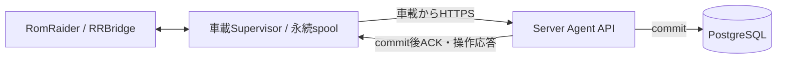
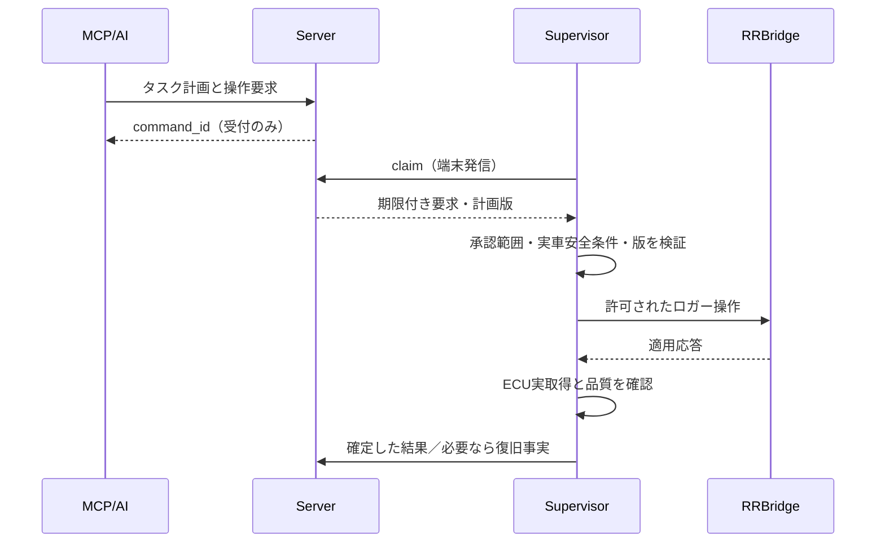

# RomLogger Server–Agent 外部インターフェース概要

| 項目 | 内容 |
| --- | --- |
| 文書ID | RLG-IF-SA |
| 版 | 1.0.0 / 2026-10-12 |
| 状態 | 製品向け論理IF概要の設計ベースライン（ワイヤ契約は別文書） |
| 上位 | [要件定義](../system_requirements.md)、[基本設計](../basic_design.md) |
| 具体仕様の正本 | **[Server–Agent通信契約v1](server_agent_wire_v1.md)** / [OpenAPI 3.1](agent_api_v1.openapi.json) |
| PoC | [RomRaider_agent/docs/10_interfaces.md](https://github.com/zawa356/RomRaider_agent/blob/main/docs/10_interfaces.md)（別世代） |

本書は、通信の**目的・責任・整合性の原則**をまとめた設計概要である。URI・HTTPメソッド、JSONのフィールドと値、ACKの原子性、認証・エラーコードについては **[RLG-IF-SA-WIRE](server_agent_wire_v1.md) が優先**し、異なる重複規約を作らない。既存PoCのC1〜C14とは互換性を保証しない。

## 1. 接続境界

- 端末はServerへ**アウトバウンド接続**する。車載PCの公開待受は要件としない。
- **実車安全判定と最終的な操作実行可否は車載側**。Serverはタスク・承認範囲・要求状態を管理。
- 長期原本はServer DB。車載側のspoolは未ACKの原本を耐再起動保護する。
- MCPは別の認証境界・別IFとし、Server内部機能を経由して操作要求・解析情報を扱う。
- 実車の接続・取得成功はこの文書の成立だけでは証明されない。

## 2. 論理IFの責務

| IF | 役割 | 相手 | 保証・制約 |
| --- | --- | --- | --- |
| IF-001 | 観測・イベント・定義の転送 | Agent → Server | 取得済み原本を失わずServerへ到達させる |
| IF-002 | 保存確定ACK | Server → Agent | **永続化commit後のみACK**。受信成功と混同しない |
| IF-003 | 状態・品質の同期 | Agent → Server | 実ECU取得と接続試行、転送未着を区別 |
| IF-004 | Logger定義とECU対応の同期 | Agent → Server | 定義の存在、適合性、実取得実績を分ける |
| IF-005 | AI計測操作の取得 | Agent → Server → Agent | 期限・計画版・承認範囲を保持し、実行判断は車載側 |
| IF-006 | 実行結果・再接続照合 | Agent ↔ Server | 要求受付、車載適用、正常性確認を区別 |
| IF-007 | 共通規約 | 双方向 | 端末別認証、契約版、一意ID、エラー、時刻、互換性 |

## 3. 転送の原則

1. RRBridgeが取得した値は、転送より先に**ローカル永続spoolに保全**する。
2. spool保存済みの観測は少量バッチで速やかに送る。通信断・サーバー停止時もロガーを停止しない。
3. Serverは検証と冪等性判定を実施し、**バッチ全体を同一DBトランザクションで確定**する。部分commit＋全件ACKは不可。
4. Serverが返した保存確定応答をAgentが検証した後で、該当IDをACK済みとして記録する。
5. 応答が失われた場合は同一record_idで再送し、Serverが重複を排除する。
6. Serverに正本保存済みの原本は期限切れで自動削除しない。車載ACK済みspoolは容量を回収してよい。
7. 古い滞留と最新値の転送を並行進行させるため、**ACKを単一連続バイト位置だけで追跡しない**。取得順と到着順は別。
8. 容量不足・spool保存失敗・取得ドロップ・未着・確定欠損を可視化する。絶対無損失を無条件には約束しない。

通信形式v1は**HTTPS + JSON**。識別子はUUIDv4等の不変IDを用いる。プロファイル定義は登録済み版を参照し、定義がないサンプルを正常ACKしない。具体的な適用順、エラー応答、例示データは[通信契約v1](server_agent_wire_v1.md)を参照。

## 4. 非同期操作と安全

- 非互換、期限切れ、重複、再接続時の結果不明は安全側に拒否・保留して**安易に再実行しない**。
- **走行中のプロファイル変更は検証済み安全条件を満たす範囲のみ**で有効化。現在の測定項目から車速が外れた等の場合、安全性を推定しない。
- Server未着のみを理由にECU異常と断定したり、勝手に切替しない。
- ローカル手動介入を検知したらAIの自動変更を停止し、実機状態を照合する。
- 切替前に取得済みのサンプルを保護し、変更中の欠測はそのまま明示する。
- ロガー操作の成功応答と、正常な実サンプルが得られたことは別の状態。

## 5. v1の具体通信契約と検証

**実装者は必ず [Server–Agent通信契約v1](server_agent_wire_v1.md) と [OpenAPI 3.1](agent_api_v1.openapi.json) を読むこと。**

同文書で既定選択した主な事項：

| 項目 | 選択 |
| --- | --- |
| HTTPパスの版 | `/api/agent/v1/` |
| メッセージ | JSON（UTF-8） |
| ID | UUIDv4の不変record_id／run_id／segment_id、送信単位のbatch_id |
| データ定義 | 不変なprofile_revisionを先行登録 |
| バッチACK | 原子的全件commit。正常応答はバッチIDと件数を照合 |
| 冪等 | 同一ID同一内容＝重複、同一ID異内容＝409 |
| 端末認証 | 端末別Bearer + TLS（初版設計選択） |
| 転送エラー | 原本維持。修復可能なバッチは問題レコードを隔離し残りを再編成 |
| 操作API | 期限・版・状態照合、実車安全条件で最終拒否できる |
| 試験 | CT-01〜15を契約試験として実施 |

通信契約v1の選択値は**開発初期仕様**であり、性能測定や実装試験結果で改訂してよい。改訂時は両側のコードと同じ時点に仕様・試験を更新する。

## 6. 開発順序・互換性

Serverの最小受信基盤を先行構築し、合成データで受信・ACK・重複・失敗時の無誤ACKを確認した後にRRBridgeを接続する。実ECUテストは次段階。MCP・Supervisor・高度監視は順次追加する。

既存PoCの`docs/10_interfaces.md`は現行実装を説明する資料として保持するが、新しい製品IFには流用を義務付けない。製品v1対応のServer/Agent間でのみ契約の整合性を保証する。

## 改訂履歴

| 日付 | 版 | 内容 |
| --- | --- | --- |
| 2026-10-12 | 0.1.0 | IF-001〜007の初稿 |
| 2026-10-12 | 0.2.0 | 文書重複を解消し具体仕様をWire v1へ一本化 |\n| 2026-10-12 | 1.0.0 | Server／Agent詳細設計と整合、製品v1設計資料として基準化 |
