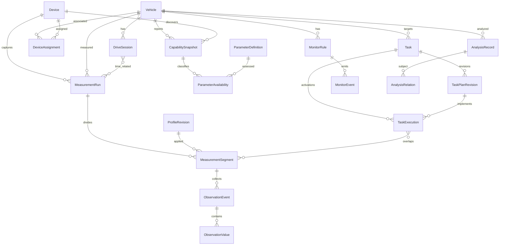

# RomLogger 論理データ設計書（初稿）

| 項目 | 内容 |
| --- | --- |
| 文書ID | RLG-LDM |
| 版 | 0.1.0 |
| 作成日 | 2026-10-12 |
| 状態 | 初稿・レビュー中 |
| 上位文書 | [要件定義書](system_requirements.md)、[システム基本設計書](basic_design.md) |
| DB製品 | PostgreSQL（確定） |
| 非対象 | テーブルDDL、データ型幅、インデックス方式、JSONB／縦持ちの確定 |

## 1. モデル化の原則

1. **車両、デバイス、走行、計測実行、計測セグメント、計測タスク**はそれぞれ独立した識別・ライフサイクルを持つ。
2. サンプルの原本は「取得イベントとそれに含まれる観測値の集合」。集計・補間・平滑化・単位換算後の派生値を原本に上書きしない。
3. Serverに原本を無期限保持する。車載spoolはサーバー保存確定までの保全領域であり、正本の長期二重保管ではない。
4. 出来事の時刻、ロガー取得順、Server到着順を混同しない。取得イベント内の複数パラメーター値についてECU内部での厳密同時性は保証しない。
5. 発見済みパラメーターと実ECUで取得確認済みパラメーターを区別し、取得定義の変化を追跡する。
6. 数値異常と欠測は別の状態。合成試験データは解析可能でも実ECU由来と誤認させない。
7. ここでの一意性・関連は**論理要件**。識別子の具体的なエンコードやFK／索引は詳細設計で決める。

## 2. コアエンティティ

| 論理エンティティ | 概要 | 主な属性・関連 |
| --- | --- | --- |
| Vehicle | 計測対象車両 | 車両識別、ECU識別履歴 |
| Device | 認証されるWindows車載端末 | 固有ID、認証状態、端末バージョン、最終通信時刻 |
| DeviceAssignment | Deviceが特定Vehicleを扱った期間 | 期間、識別の確信度、切替履歴 |
| CapabilitySnapshot | Logger定義とECU対応の観測時点スナップショット | Device・Vehicle・ECU・Logger定義版・取得時刻 |
| ParameterDefinition | パラメーターの版管理された定義 | ID、名称、単位、換算・定義来歴、定義版 |
| ParameterAvailability | 定義項目の利用可能性 | 候補／適合判定／実取得確認／未対応／不明と根拠 |
| DriveSession | エンジン始動から停止までの走行単位 | 開始／終了、根拠、推定／未確定、Vehicle |
| MeasurementRun | ロガーの実行単位 | Device、Vehicle、開始／終了、終了理由、取得状態 |
| MeasurementSegment | 計測定義の同一性を保つ区間 | Run、プロファイル版、開始／終了、切替契機 |
| ProfileRevision | 実際の計測項目集合と定義の版 | 項目識別・単位・設定、適用時刻、作成根拠 |
| ObservationEvent | 1回のデータ更新通知による取得原本 | 不変ID、Run、Segment、取得順、観測時刻、実ECU／合成の種別 |
| ObservationValue | 取得イベント内の各計測値 | ObservationEvent、ParameterDefinitionの版、値、単位、値品質 |
| AcquisitionGap | 取得されなかった期間や未着区間の記録 | Run／Segment、開始・終了、状態、欠落根拠 |
| OperationEvent | 接続・変更・失敗等の操作証跡 | 状態遷移、要求元、理由、関係するRun／Segment |
| Task | 複数走行を横断する計測目的 | Vehicle、目的、承認範囲、状態 |
| TaskPlanRevision | Taskに属する改訂可能な宣言的計画 | 版、対象項目、必要品質、作成理由、採用状態 |
| TaskExecution | Taskを計測に反映した実行区間 | Task／計画版、Device／Vehicle、適用時間、結果 |
| CommandRequest | Serverから車載へ配送される操作要求 | 対象、承認範囲、期限、要求状態、実機適用結果 |
| MonitorRule | LLM非依存の数値・品質監視条件 | Vehicle／対象、条件、版、有効期間 |
| MonitorEvent | 監視条件により検出された出来事 | Rule、時刻、品質、根拠区間、確認状態 |
| AnalysisRecord | AIが作成する追記型解析結果 | 結論、根拠、確からしさ、チャットを超える識別 |
| AnalysisRelation | 解析記録間の関係 | 補足／修正／撤回／再評価と対象記録 |

各エンティティ名は説明上の論理名であり、1テーブル＝1エンティティを強制しない。

## 3. 関係と多重度

このER図は概念モデル。DriveSessionとMeasurementRunは時間的重なりで関連付け、強制的な親子関係にしない。1つの計測実行が複数の走行境界をまたぐ場合、あるいは走行中にロガーを再起動した場合も表現できるようにする。

### 3.1 走行セッション

走行の開始・終了は可能な限りエンジンの始動／停止から判定する。ロガー開始＝走行開始とは定義しない。通信切断やRomRaider再起動のときは、始動・停止の根拠が不足する可能性があるため、**確定・推定・未確定**を表現できる必要がある。後から証拠が増えた場合に境界評価を改訂しても、取得原本を変更しない。

### 3.2 計測タスクと走行

複数タスクを登録・保管できるが、Vehicle単位で現時点に適用中の**計測タスクは原則1件**。TaskExecutionの有効期間を用いて、同一走行の前半をタスクA、後半をタスクBとする関係を記録できる。同じTaskを翌日以降の複数DriveSessionに再適用することもできる。期間外の全サンプルを誤って当該タスクへ帰属させない。

### 3.3 プロファイルとセグメント

セグメントは実際に適用された取得項目・定義版の安定区間として扱い、計画上の項目リストと実機適用結果を区別する。変更中の欠測を隠さない。途中のRomRaider内部更新通知が一時的に項目集合を変える可能性があるため、**項目変更を受信した事実**と**適用が正常確認された計測構成**を区別する。

## 4. 原本の識別と変更禁止

各ObservationEventは、再送・端末再起動・サーバー切替を経ても不変となる識別を持つ。複数車両／デバイス／計測実行間で衝突しないことを契約とし、IDをどう生成するかはIF仕様で定める。

- 同一ID・同一内容の再受信は既保存として扱う。
- 同一ID・異なる内容は整合性違反であり、黙って上書きしない。
- 取得順と時刻は別概念。時刻補正による逆行や欠測が起きても元の順を復元できること。
- RomRaiderが出力した換算済み値を取得した場合、その**取得時点での換算済み観測値**が原本。ECU通信の生バイナリを保存することは要求しない。
- 未測定、更新停滞、転送未着、再送待ち、消失確定、値の欠測／不正、合成データを区別する。
- 「プロファイルに項目がある」と「サンプルに有効な値がある」は別。
- 取得イベント全体は一つの通知の集合であり、値がECU内の同時刻に測定されたことの証拠とはしない。

## 5. 時刻・遅延・品質

| 要素 | 使用目的 |
| --- | --- |
| 観測時刻 | 時系列分析。原則RomRaider側で値を受け取った時刻 |
| 取得順序 | 時刻補正・非順序送信時でも観測イベントの順を維持 |
| spool永続化状態 | ACKまでの保護。処理遅延評価は必要な粒度で保持 |
| Server保存確定時刻 | 転送鮮度・遅延・運用状態を評価 |
| 定義適用時間帯 | 前後のプロファイル差・セグメント分割 |
| 品質状態 | 未着／欠落確定／取得停滞／転送遅延／未計測／不明 |
| 品質指標 | 実測Hz、間隔分位、最終サンプル経過、ECUエラー、ドロップ、滞留 |

全観測イベントに3種類の時計を持たせることは要求しない。Server到着時刻だけでECU観測の瞬間を代用せず、複数端末を横断した相対時刻比較には時計不確かさを考慮する。

## 6. 柔軟なデータ検索の論理仕様

AI向けMCPと内部Server APIは、原本に対応する全時系列への段階アクセスを提供する。

| 機能 | 範囲 |
| --- | --- |
| 行選択 | Vehicle、DriveSession、MeasurementRun、Segment、TaskExecution、時刻・取得順区間 |
| 列選択 | ParameterDefinitionのID／版、関連する観測時刻・品質等 |
| 条件選択 | 指定列の比較、範囲、AND／OR、欠測・合成／実ECU種別 |
| ソート | 時刻・取得順の昇降順など、安定したページングに必要な順序 |
| ページング | 大量結果の分割、続きの位置、全量／残数の識別（可能な範囲） |
| 出力 | 項目を列に展開した観測表現、取得イベント／値の詳細、統計処理 |

任意SQLや無制限のDBクエリをMCPに公開しない。データを勝手に間引いて原本の代わりに返さない。巨大な結果の切り詰め・欠測・パラメーター変更により列が存在しない部分を明示する。

## 7. サーバー監視・AI解析履歴

MonitorRuleはAIがMCPから設定でき、登録後はLLM無しで持続評価する。評価対象の値が未着・未測定の際には、正常・異常に短絡しない「判定不能」を扱う。MonitorEventは条件、継続時間、関連する原本範囲、対応結果を持つ。

AnalysisRecordは追記型で、Task、Vehicle、対象走行、対象期間、関連Segment、根拠となる検索範囲またはObservationEvent集合、解析時点のデータ品質を参照できる。過去の結論が有効か、訂正・撤回済みかをAnalysisRelationから確認できる。AI側がMCPの保存を毎回必ず実行すると仮定しない。

## 8. DB実装と保全の境界

- PostgreSQLに原本と関連する管理情報を永続化する。
- 取得イベント単位の原本を表現でき、列・値条件検索を支える物理設計を採用する。
- JSONB、値の正規化、補助索引、パーティション分割、集計用派生データは性能・実装容易性で詳細設計時に選ぶ。
- アプリ側が期限切れで原本を自動削除しない。再送との競合や部分失敗を安全に扱えるトランザクションを採用する。
- DBの物理バックアップ、レプリケーション、ストレージ冗長化はインフラ側の責務として対象外。

## 9. 残課題

| ID | 論点 |
| --- | --- |
| LDM-OPEN-01 | ObservationEventの安定ID生成・再起動後の衝突回避 |
| LDM-OPEN-02 | 計測実行・走行セッションの自動境界判定と未確定状態 |
| LDM-OPEN-03 | Logger定義更新時のParameterDefinitionの版付けと同一性 |
| LDM-OPEN-04 | 合成・実ECUの混在防止と試験データの表示方針 |
| LDM-OPEN-05 | 項目別行検索と取得イベント単位原本の物理配置 |
| LDM-OPEN-06 | タスク切替とセグメント境界の帰属・競合 |
| LDM-OPEN-07 | 複数時計とサーバー照合時の時刻不確かさ |
| LDM-OPEN-08 | 監視ルールの版管理と解析根拠の永続参照 |

## 改訂履歴

| 日付 | 版 | 内容 |
| --- | --- | --- |
| 2026-10-12 | 0.1.0 | BD-002／004／005に対応する概念モデルの初稿 |
