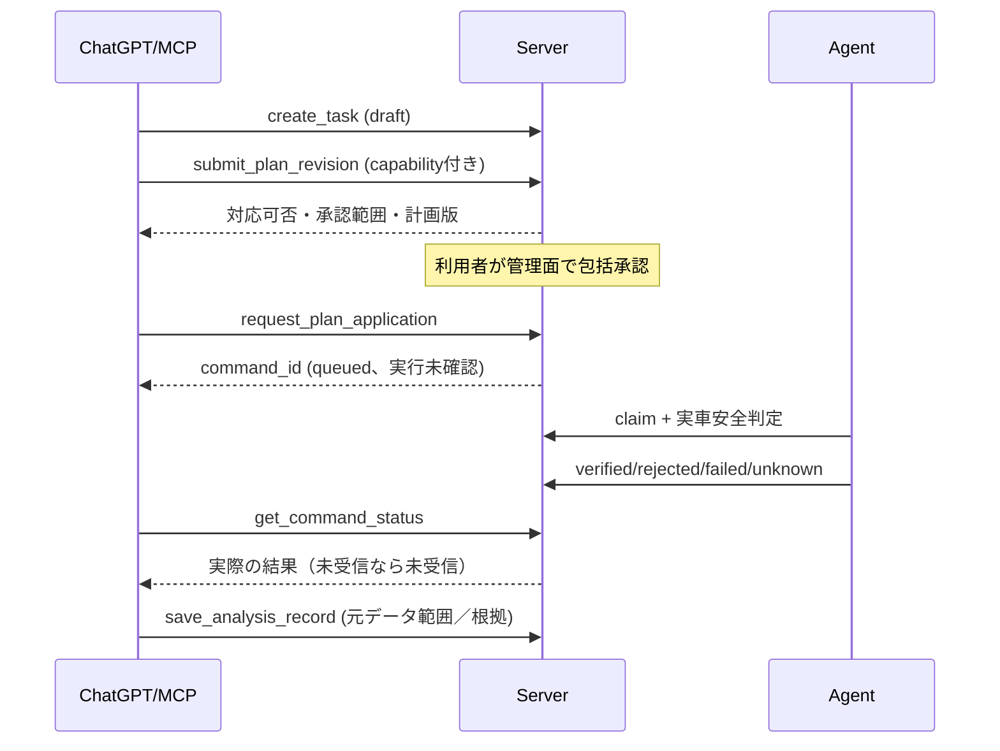

# DD-MCP-001 MCP・AI操作・解析詳細設計

| 項目 | 内容 |
| --- | --- |
| 文書ID | RLG-DD-MCP |
| 版 | 1.0.0 / 2026-10-12 |
| 状態 | 設計ベースライン。**ChatGPT通常／Liveの認証・書込み操作は実機接続未検証** |
| 上位 | [MCP IF](interfaces/mcp.md)、[基本設計](basic_design.md)、[Server詳細](server_detailed_design.md) |
| 機械可読な検索引数 | [MCP Query JSON Schema](interfaces/telemetry_query_v1.schema.json) |

## 1. MCPの実行モデル

- MCPはAIからの**明示的なツール呼出し**に応答する。ServerからChatGPTへ任意時点で呼び出し・推論・音声発話させる設計にはしない。
- 標準的なリモートMCPのStreamable HTTPを初期候補とし、外部HTTPSの`/mcp`を提供する。クライアント固有のSSE／HTTP互換性は実際のMCP SDKとChatGPT通常／Liveで接続検証する。
- MCPの接続処理と、Serverの永続監視／計測は独立。MCPの再接続でDB原本・タスク・監視状態が失われてはならない。
- Serverはバックグラウンドの有料LLM推論を実行しない。AIが不在でもルール判定・spoolからの受信・復旧照合は継続。
- MCP tool名は[基本IF](interfaces/mcp.md)の名称をv1の安定識別とし、入力・出力schemaの不整合を合同テストで検出する。

## 2. 認証選定

**本番MCPにOAuth系の標準的な認可サーバーを接続し、MCP自身は保護対象リソースサーバーとして振る舞う**設計とする。

- MCP側はアクセストークンのissuer/audience/期限/署名/スコープ等を検証し、車載向けBearer tokenとは別物として扱う。
- MCPの保護リソースメタデータ（RFC 9728）や認可サーバーメタデータ（RFC 8414 / OpenID Connect Discovery）を実装・公開する構成を第一候補とする。
- OAuth 2.1相当のAuthorization Code + PKCEを前提とし、外部ユーザー向けの自作パスワード画面・認証サーバー実装を初期必須としない。小規模セルフホストで導入可能な既製IdPを使う。
- 実運用のOAuth/OIDCプロバイダー、ChatGPT接続時の更新トークン動作、Liveの対応は**実クライアント試験で確定する**。認証が成立しないからといって実ECUの本番MCPを匿名化することは禁止。
- MCPクライアントが要求する一時的なユーザー確認ダイアログは、製品側のタスク包括承認とは別。MCP側UIの再確認が毎回ないことを保証しない。
- 既存PoCの一時的公開HTTPSトンネルと合成データMCPは本番の実車データ・権限・認証と隔離する。

参考規格（2026-10-12時点の設計参照）：
[MCP Authorization 仕様](https://modelcontextprotocol.io/specification/2025-11-25/basic/authorization)／
[OAuth Protected Resource Metadata RFC 9728](https://www.rfc-editor.org/rfc/rfc9728)／
[OpenAI custom MCPアプリの接続に関する案内](https://help.openai.com/en/articles/12584461-developer-mode-and-full-mcp-connectors-in-chatgpt)。
いずれも実際の対象クライアントでサポートされる機能を検証してから公開する。提供プラン・権限による制約を区別する。

## 3. 権限と確認の二重境界

| 権限 | 代表的ツール | 判定場所 |
| --- | --- | --- |
| reader | list_vehicles, status, raw query, list_events, history | MCP利用者token＋vehicleスコープ |
| analyst | save_analysis_record, upsert_monitor_rule | Serverの権限チェック＋対象vehicle |
| planner | create_task, submit_plan_revision, request_plan_application | Serverの利用者スコープ＋計画と承認範囲 |
| admin | device／vehicle割当、token管理、包括承認 | 初版はMCP外の管理CLIまたは厳格に認証した別管理面 |

**二重境界:** (1) MCPユーザーが該当ツールと車両にアクセスできるか、(2) その計測操作が登録済みTaskのApprovalScopeに含まれるか。これらを満たしても(3) 車載SupervisorとRRBridgeによる安全ゲートが必要。AIが承認済みと口頭で述べただけでは2を満たさない。

## 4. テレメトリー検索の意味論

### 4.1 行・列・検索対象

- **行:** 1ObservationEvent＝1行。行選択はvehicle（必須）、drive_session、run、segment、task実行期間、時刻区間、実ECU／合成、品質条件を組み合わせる。
- **列:** parameter_idの配列＋許可されたメタデータ列。過去のProfileRevisionに同じparameter_idでも単位・意味が違う場合は版指定または明示換算を必要とする。
- **値条件:** AND／ORで構成した小さなAST。比較演算子`eq/ne/lt/lte/gt/gte/between/in`と`is_missing/is_present`を許可する。
- **欠測:** 存在しない列はNULL＋`missing_reason`。演算はSQLに似た**3値論理（true/false/unknown）**を基本とし、unknownはWHEREとして通過させない。`is_missing`だけが明示的に欠測を選べる。
- **相関:** 同じ観測イベントにパラメーター値がない場合、**過去値を暗黙にforward fillして同時測定扱いにしない**。時間軸上の補間が必要なら別の明示分析サービスで原本へのリンクを残す。
- **固定列の優先:** 複数プロファイルを跨ぐ検索で列が途中から存在しない場合、その列はnullを返す。値0の代用は禁止。
- **合成:** source_kind=syntheticの行を実ECUの数値としてAIへ説明しない。検索の既定は実ECUに限定し、syntheticは明示的なinclude指定で取り出す設計とする（テスト環境では別既定を選べる）。

### 4.2 安全なクエリ処理

入力は[制限付きJSON Schema](interfaces/telemetry_query_v1.schema.json)で受ける。Serverはさらに、認証された車両、parameter版の一致、ASTの最大深さとノード数、時間範囲、対象列数、値配列長、ページ行数・バイト数、DB実行時間を検証する。

安全なQuery AST→パラメーター化SQLへ変換。任意SQL、SQL片文字列、テーブル名、自由なjoin句、OSコマンドは拒否。

WHERE内の`ne`もパラメーター未取得ではunknownであり、意図せず「P8 != 3000」をすべての欠測に一致させない。

### 4.3 レコードを起点とする前後ナビゲーション

通常のページ継続用`next_cursor`とは独立し、既知の観測Aの`record_id`から「次に取得したB」「B以降100件」等を1ツール呼出しで取得する。入力は[検索Schema](interfaces/telemetry_query_v1.schema.json)の`anchor`（record_id、after/before）に従い、結果は既存と同じ`rows[]`（配列）を返す。

1. 認証されたvehicle内にanchor `record_id`があることを検証。他車両・不存在の区別を過度に露出せず安全に拒否。
2. 当該観測の`run_id`と`sequence`をDBで解決。v1は**自動的に同じrunに限定**し、同じvehicle内でも別runのBを返さない。
3. afterは`sequence > anchor.sequence`、beforeは`sequence < anchor.sequence`を適用する。該当観測A自身を返さない。
4. 「次」は**保存済みの取得イベントの論理的な次**。sequenceの欠番があるなら次に存在するイベントを返し、欠番を無理に生成／補完しない。Gapと未着がある場合は品質情報から区別できる。
5. `where.is_present(parameter_id)`を指定すれば、そのパラメーターが実際に取得された観測だけを返す。フィルターなしでは途中プロファイルの未計測null行が混じり得る。数値条件・単位・profile版の扱いは通常queryと同一。
6. afterは`sequence ASC`で直後からN件を選び、そのまま応答。beforeは`sequence DESC`で直前からN件を選択し、**出力時にsequence ASCへ整列**する（つまり近傍N件が返り、先頭から遠いN件を誤って取得しない）。
7. `order`が明示される場合は`sequence asc`のみ許可。省略時もanchor検索はこれを標準とする。一般の時刻／runをまたぐ検索では従来のorder仕様を維持。
8. anchorに**非nullのcursor**を同時指定することを禁止。最初のanchor検索の`next_cursor`から先は、同じfilter/scope/selectを再指定してcursorでページ継続する。cursorは元のanchor、検索境界、最後の返却キーと認可主体を保持し、アンカーの繰り返し実行と混同しない。
9. anchorは「検索開始位置」を決めるためのもので、WHERE値条件そのものに一致する必要はない。ただし指定runや時間scopeと矛盾するときは拒否。検索snapshopの確定取込watermarkによって、後着レコードが既存ページへ割り込まない。

**用例:** 4件の保存済み同一run観測A(seq=10)、B(11)、C(12)、D(13)について、Aをanchor、after、limit=3、where P8 is_presentとすれば**B/C/Dの3行が1回**で返る。`limit=1`ならBのみ。A→B間にseq=11の欠番があれば、次の保存済みデータCが返るが、Bが完全に存在しないのか未着かは別情報として示す。

### 4.4 ページング・安定性

- 初回取得時、閲覧車両についてDBが**commit済みとして確定したingest watermark**を固定し、カーソルに埋め込む。DB側の書込みとスナップショット境界は同じ車両ロックの規則に従う。
- ソートは指定sortとタイブレーク（run_id、sequence、record_id等）で完全順序を持つ。次ページは`WHERE tuple > last_tuple`型のkeyset pagination。
- カーソルはquery_hash、認証主体、vehicle、取込境界、有効期限、last keyを署名またはServer保存。異なる条件・別ユーザーで再利用不可。
- Serverは長時間開いたDBトランザクションを必要としない。後着の**古い観測時刻**が結果途中に混ざらないようingest watermarkで固定する。
- 大量データの1回の応答での無制限出力は禁止。初期デフォルト1,000行／最大5,000行（さらにbyte上限）。全件アクセスは複数ページで実現。
- MCPホスト側のメッセージサイズ・利用権限・ツール回数制限によって、AIが1対話で全件を処理できるとは保証しない。必要なら範囲を狭めて反復分析する。
- 取得済みデータの品質とServer未受信可能性を別に説明する。結果0件は「ECUが測定していないことが確定」とは意味しない。

## 5. 過去データ、セッション、時刻

- `get_vehicle_status`は`last_reported_at`と`last_received_at`、`last_real_sample_at`を区別。ECUが応答していない場合でもLoggerプロセスは起動済みのことがある。
- `list_drive_sessions`は境界確度と推定理由を併記。エンジン停止・始動を観測できなければunconfirmed。
- `list_measurement_runs`はロガー再起動によるRunの分離を示し、セッションは必ずしも閉じない。
- `list_parameters`は定義上の候補／ECU適合推定／実取得確認を区別し、capability snapshotの鮮度・Logger定義版を添える。
- セグメント境界のプロファイル・時刻・イベントを返し、未計測区間や変更途中をAIが観測値と誤認しない。

## 6. タスク・計画・保存済み解析履歴



- Plan改訂はimmutable revisionとoptimistic concurrencyを用い、現在適用版と同じという証拠がなければ古い版を適用させない。
- 1車両で同時実行する計測タスクは原則1件。同一走行に複数タスクを**時間で区切って**紐付けできる。未収集のデータをタスクへ事後的に関連付ける場合も根拠／有効期間を保存。
- `get_command_status`は要求受付／取得／適用／実ECU取得確認を分け、未確認実行はunknown。
- `save_analysis_record`は対象車両、Task／走行／時間・データ検索条件・snapshot reference・確信度・結論・未解決事項を登録し、登録成否を返す。結果修正は新レコード＋修正／撤回関係。
- 解析履歴はMCPクライアント間で共有されるServer DBの記録であり、ChatGPT会話のメモリに依存しない。AIが必ず保存ツールを呼ぶとは仮定しない。

## 7. 監視ルールのDSLとサーバー側評価

初版の監視式は以下のような**宣言的な限定AST**で表現する（MCPで任意PythonコードやSQLを受け取らない）。

```json
{
  "rule_id": "f4ad9b62-7fc2-4923-b67c-8a1caa1d109b",
  "vehicle_id": "6f58c2f3-b65d-40a1-8e54-f5eff9b02c23",
  "predicate": {
    "and": [
      {"metric": "P8", "op": "gte", "value": 3000},
      {"metric": "P13", "op": "lte", "value": 10}
    ]
  },
  "require_duration_ms": 2000,
  "recovery_hysteresis_ms": 3000,
  "severity": "warning",
  "missing_data": "unknown"
}
```

ルール作成時に参照項目の単位・能力・定義版と評価周期を検証する。継続時間の判定で欠測がある場合は、真のまま補間して閾値超過と推定しない。Server workerが評価してMonitorEventを記録。重複通知・再評価はルール版と原本範囲で識別。車載側の安全判定とは独立。

## 8. MCPツールのインターフェース試験

| ID | テスト |
| --- | --- |
| MCP-T01 | 正しいOAuth／MCPセッションでread-only toolsを呼出し |
| MCP-T02 | tokenのaudience・車両スコープ違いで403／秘匿 |
| MCP-T03 | 異なるchat/MCPセッションから同じ原本・解析履歴が検索可能 |
| MCP-T04 | 期間・行・列・AND/OR・0行・欠測・版変更・合成除外が正しい |
| MCP-T05 | 無制限件数／巨大AST／SQL文字列は拒否または制限 |
| MCP-T06 | cursor改ざん／別ユーザー流用／期限切れで正しく拒否 |
| MCP-T07 | 途中で過去観測時刻の新データが届いても元cursorのページ結果不変 |
| MCP-T08 | Plan受付と車載verifiedが別状態として表示される |
| MCP-T09 | AI解析結果が追記され、訂正・撤回後も元データに到達 |
| MCP-T10 | 監視ルール保存後はLLM不在でも継続判定 |
| MCP-T11 | ChatGPT通常／Liveで接続と実際に呼べるツールの範囲を記録 |
| MCP-T12 | 本番匿名MCPは実データ閲覧・操作不能 |

## 9. 検証不能な外部依存

- ChatGPTのMCPアプリ・コネクタ作成可否、OAuth認可、ChatGPT Liveでのツール発見・実行、書込み系ツールに対するホスト側の追加確認は**ユーザーのプランや時期・クライアント環境により異なる**。PoCの合成ツール成功を全本番ツールへ一般化しない。
- 本番接続にOAuth/OIDCが採用できない場合、匿名MCPへの切替を禁止。実対応する**認証された代替方式**を別の設計変更で検討する。
- 解析結果の自動記録、5分ごとの再呼出し、Discord通知はAI側・運用側で必要な権限があり動いた範囲だけを保証する。
