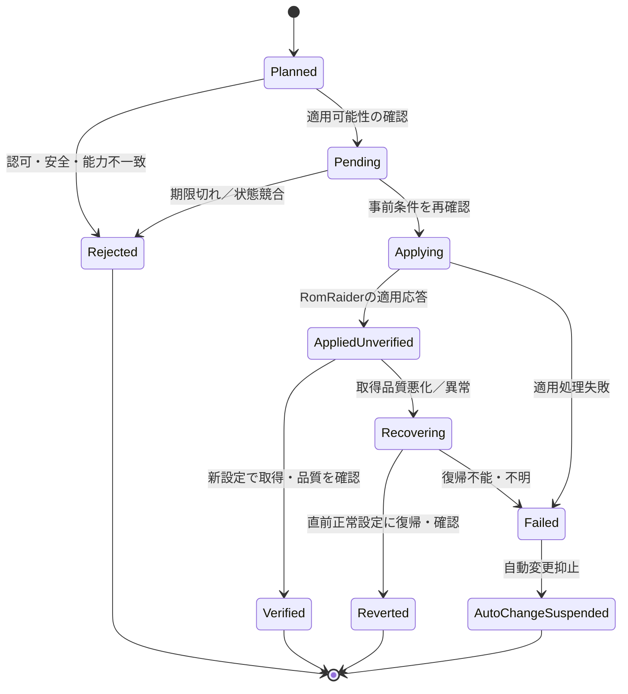

# 車載安全・復旧設計と技術検証計画

| 項目 | 内容 |
| --- | --- |
| 文書ID | RLG-SAFETY-VAL |
| 版 | 0.1.0 / 2026-10-12 |
| 状態 | 安全方針・検証計画の初稿。**実機検証済みではない** |
| 上位 | [要件](system_requirements.md)、[基本設計](basic_design.md) |
| 関連IF | [Server–Agent v1](interfaces/server_agent_wire_v1.md) |

## 1. 安全境界

RomLoggerは**ECU読み取りテレメトリー**を対象とし、ROM書込み・フラッシュ、ROM読書き、DTC消去、ECUリセット、アクティブテスト、学習値リセット、OpenPort FW更新等の機能を提供しない。任意のコマンド／ファイルパスをAIが車載側へ届けられないよう、サーバー・Supervisor・RRBridgeの各段階で許可操作を限定する。

安全の責任分担は、Serverが「ユーザー承認・対象・有効期限・計画版」を判断し、Supervisorが「現在の実車状態に適用できるか」を最終判断し、RRBridgeが「RomRaider内部で許可した操作だけを実行する」こととする。どれか1層で検証ができない場合、安全条件を満たしたと推定しない。

## 2. 動作モード・優先順位

| 状態／操作 | 原則 |
| --- | --- |
| 手動モード | RomRaider通常利用。AIによる自動変更機構を接続しない |
| AI連携モード | 起動時に選択。ServerやLLMがなくても基本計測は継続 |
| AI計測タスク | 車両ごとに実行中の主タスクは原則1つ。登録・履歴は複数可 |
| 包括承認 | 計測目的・変更範囲・期限について一度確認し、範囲内の変更は個別再承認不要 |
| ローカル介入 | AI操作より優先。手動変更を検知したら自動変更を抑止して実機とServerを照合 |
| 緊急停止／自動変更抑止 | 独立した操作手段を提供。既存の保存済み原本は保持 |
| Server切断 | AI新規計画を停止、直前の正常計測を維持。車載局所監視と保全は継続 |

**計測状態の変化と運転状態の変化を混同しない。** エンジンON/OFFや車速情報が未取得であれば、停車中とみなさない。

## 3. 車載安全ゲート

プロファイル変更は、次の条件が**すべて**成立して初めて候補となる。

| ゲート | 検査内容 | 否定／不明のとき |
| --- | --- | --- |
| SG-01 認可 | 認証されたタスク／承認範囲内の要求 | 拒否 |
| SG-02 鮮度 | 計画版、有効期限、操作ID、期待する現在状態 | 失効／競合なら拒否 |
| SG-03 対応 | Logger定義、ECU識別、対象項目、単位、選択可否 | 未対応なら拒否 |
| SG-04 安全入力 | 車速等、必要な情報の独立性と鮮度、ECU／ロガー状態 | 不明なら保留／拒否 |
| SG-05 計測品質 | 現在の取得周期・通信エラー・滞留など | 定量的に問題なら保留／拒否 |
| SG-06 データ保全 | 切替前取得済みのサンプルが安全にspoolへ反映済み | 不明なら切替延期 |
| SG-07 実行許可 | 許可リストの読み取り／ロガー制御操作であること | 拒否 |
| SG-08 操作競合 | ローカル手動介入や別コマンドがないこと | 自動変更抑止／再照合 |

SG-04の独立情報源は**車両やOpenPort通信量に応じて要検証**。現在の計測プロファイルに含まれる車速P9を前提とした安全判定は、その項目をAIが外した時点で有効性を失い得る。安全入力のために追加K-Line問い合わせを行う場合も、サンプリング品質と同時実行の影響を実測する。

## 4. 走行中切替の有効化ポリシー

- **製品目標は条件付き走行中切替**。恒久的な停車専用仕様にはしない。
- しかし安全条件、切替所要時間、ECU通信負荷、故障時の復帰、実車での動作が検証されるまでは、**走行中の自動切替を有効にしない**。
- 初回実機検証は停車状態で実施。試験車両、ECU、RomRaider版、OpenPort、Logger定義、パラメーター数・長さを記録。
- 走行時の段階評価は法規・運転安全を優先し、運転者のPC操作を前提にしない。
- 試験に合格した組み合わせのみ許可範囲を拡げる。未知の車両、異なる定義、失われた安全入力へ推定適用しない。
- PoCの停車ガードを、新版の検証が終わるまで理由なく解除しない。

## 5. 切替の状態モデル

状態コードそのものはServer–Agent v1のreport契約に従う。上図の「復帰済み」は操作を実行しただけではなく、必要な範囲で正常性を確認した意味。ロガーが「起動中」であってもECU実サンプルがまだ来ていなければ、正常取得成功とは断定しない。

- 切替による計測中断・欠測は許容。データがなかった時間を補完値で埋めたと誤認させない。
- 切替前に取得済みの原本は保全し、適用前後の計測セグメント・プロファイル版を関連付ける。
- 通信断・電源断で結果不明のコマンドを再送時に自動再実行せず、実際の適用状態を確認してから確定する。
- フォールバックの再試行回数／時間には上限を設ける。ロールバックも危険と判断されるときは、無理に操作せず自動変更を停止。

## 6. 監視とフォールバックの境界

| 発見場所 | できること | 禁止／留意 |
| --- | --- | --- |
| 車載Supervisor／RRBridge | ECU応答停滞、取得周波数の著しい低下、ロガー操作成否、spool不良。局所的な保護と可能な範囲の復帰 | ServerやChatGPTの応答待ちで安全処理を止めない |
| Server | 永続化された測定値の条件監視、転送未着、履歴異常、利用者向けイベント。必要なら安全な復旧要求を発行 | 未着だけをECU故障と断定しない。車載への最終強制をしない |
| AI | 原本と品質情報の再解析、次回計画の提案、未解決事項の整理 | MCPプッシュで自発的に起動すると保証しない |

実測周期・P95・最新取得時刻・ドロップなどを品質情報に含める。初期しきい値（例: 2Hz）を車種・項目数に共通の保証として固定しない。ルールの監視閾値は実データで較正し、ノイズ・観測条件・欠測を考慮する。

## 7. 最小検証マトリクス

| 試験ID | 前提／試験内容 | 期待結果 | 根拠の区分 |
| --- | --- | --- | --- |
| VAL-001 | 実ECUでRomRaiderから取得、RRBridge→spool→Server DB | 全経路で実サンプルの一致・来歴を確認 | 実ECU、停車 |
| VAL-002 | ロガー切替前／切替中／切替後 | 切替前の原本無損失、欠測区間と定義の版が明確 | 実ECU、停車 |
| VAL-003 | Server停止、回線断、ACK喪失、再送、再起動、最新優先 | 未ACK保持、重複なし、古い滞留と最新が回収 | 合成→実ECU |
| VAL-004 | 未許可パラメーター、任意コマンド、ECU制御系を要求 | Server、Supervisor、RRBridgeが適切に拒否 | 合成／静的試験 |
| VAL-005 | 車載安全入力の欠落・古さ・不整合、動作中切替 | 不明は許可しない。段階的な実機評価の範囲のみ許可 | 停車→安全検証済み環境 |
| VAL-006 | 操作登録、Agent停止、期限切れ、再起動、失敗結果不明 | 二重実行なし。実機確認前に成功確定しない | 合成／停車 |
| VAL-007 | JSON不正バッチ・DB commit失敗・ID衝突 | 未保存をACKせず、原本を維持 | Server契約試験 |
| VAL-008 | 未ACK増大・ディスク逼迫 | 警告・無断破棄防止・記録不能を可視化 | 車載障害注入 |
| VAL-009 | Live通常MCPツール、認証、解析保存 | 実際にサポートした範囲だけ記録 | MCP接続実機確認 |
| VAL-010 | 無効な監視ルール／欠測／合成データ | 故障断定せず、正しい品質・不明判定 | 単体／Server結合 |

## 8. 検証記録の最低項目

- 検証日、使用コミット／リリース、RomRaider・Logger定義・OpenPort・ECU識別情報、計測構成と時刻。
- **合成データ／実ECUデータ／実走行データ**を明示。
- サンプル件数・原本ID集合・取得周波数・転送遅延・spool状態・欠損・エラー・操作版／操作結果。
- 対象とした条件、試験前後で変更した設定、合否、観測された制約。
- 走行中切替を実施していない場合、「未実証」と表記する。

全車種・全条件の網羅試験や大掛かりな商用品質の受入書類は要求しない。主要リスクに関する最低限の確認を優先する。

## 9. 未検証課題

1. Java Agent内部接続が対象RomRaider版で長時間・実ECU取得中に安定するか。
2. ECU・速度等の**独立で信頼可能な車載安全入力**の取得可否。
3. プロファイル生成・切替中の追加K-Line通信負荷と実測更新周期。
4. RomRaiderからの取得通知の粒度と内部同期状態、セグメント境界。
5. ChatGPT通常／Liveで認証・MCP連続呼出し・解析保存の実機互換性。
6. Windows突然の電源断／スプール容量満杯と復旧方法。
7. ソフトウェア配布物（RomRaider、ライブラリ）のOSSライセンス。

## 改訂履歴

| 日付 | 版 | 内容 |
| --- | --- | --- |
| 2026-10-12 | 0.1.0 | 安全ゲート、状態モデル、未実証の走行中切替、VAL試験観点を明文化 |
