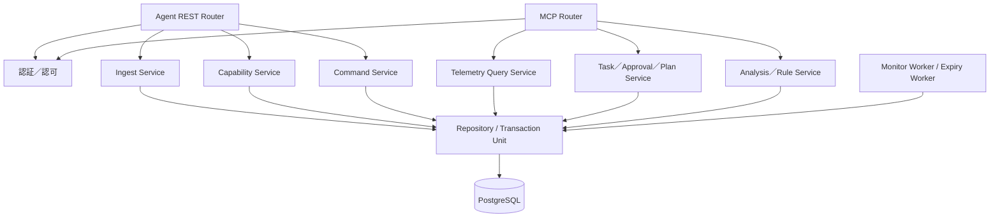

# DD-SRV-001 RomLogger Server詳細設計

| 項目 | 内容 |
| --- | --- |
| 文書ID | RLG-DD-SRV |
| 版 | 1.0.0 / 2026-10-12 |
| 状態 | **実装前の設計ベースライン。コード・実機の検証を意味しない** |
| 上位 | [基本設計](basic_design.md)、[論理データ](logical_data_model.md)、[通信v1](interfaces/server_agent_wire_v1.md)、[MCP](interfaces/mcp.md) |
| 対象外 | インフラ側DBバックアップ、ECU通信実装、LLM定期実行 |

## 1. 製品版の技術選定

初版は**Python 3.12以上 / FastAPI / SQLAlchemy 2.x / PostgreSQL 16以上 / Alembic / MCP Python SDK**を設計上の候補基準とする。選定理由はPoC検証資産、非同期HTTP、型検証、トランザクション、コンテナ配備、MCP実装の保守性。SDKの配布時点のAPIは実装着手時に固定し、実機に影響する外部ライブラリの変更を無検証導入しない。Pythonバージョン等は配布環境のサポート状況で改訂可能。時系列専用DB、Redis、Kafka、Celeryを初版の必須構成にしない。

**最初の配備:** Linux Docker Compose上の API/MCPアプリとPostgreSQL。バックグラウンド数値監視・期限処理は同じコードベースの別workerコマンド／コンテナに分離可能とし、重複worker実行時の多重通知をDBトランザクションによって抑止する。Caddy等のTLS終端はインフラ側で選択する。外部への公開はHTTPSのみ。DBポートは原則コンテナ内部・私設ネットワークに限定。

## 2. アプリケーションの責務と依存方向



- **Router:** HTTP/MCPの形と入力を検証。業務ロジックや生SQLを含めない。
- **Application Service:** 認可後の業務規則、冪等性、変更前提、失効、正常性判定、ページングを実施。
- **Repository/Unit of Work:** 全関連行のACID境界とSQLを一元化。1受信バッチは1トランザクション。
- **Worker:** メッセージ監視、ルール評価、要求失効、stale状態の診断。AI推論は実行しない。
- **Observability:** 構造化ログ、リクエストID、デバイスID、コマンドID、バッチID、処理時間、DB例外分類。秘密・全サンプル値は一般ログに出さない。

PoCの `app/` や `server/rrserver/` を移植する義務はない。機能・テストを再利用する場合もこの層分割と新IF契約を優先する。

## 3. データ受信（最初の実装工程）

### 3.1 定義先行登録

`PUT /api/agent/v1/profile-revisions/{id}` は認証済みdevice・vehicle割当、IDと本文一致、空でないparameter集合、重複parameter ID、definition fingerprint、名前・単位の長さ上限を検証する。既存IDの**正規化された意味内容が同一**なら冪等応答。異なる場合は409で既存を変更しない。変更される定義は**新revision ID**として登録し、過去の値に影響させない。

独立したローカル取得・spoolは定義登録の成否に依存しない。Serverへ送れない観測は定義登録まで車載側未ACKとして保持する。

### 3.2 原子的バッチ受信

```mermaid
sequenceDiagram
 participant A as Agent
 participant R as API
 participant D as Database
 A->>R: telemetry batch
 R->>R: スキーマ・資格情報・サイズ検証
 R->>D: BEGIN
 R->>D: 定義・Run/Segment・record ID整合性検証
 R->>D: 新規レコードと値/イベントをinsert
 alt 全件の整合性OK
   D-->>R: COMMIT成功
   R-->>A: 200 committed + 件数
 else 1件でも不正／永続化不明
   R->>D: ROLLBACK（可能なら）
   R-->>A: 4xx/5xx; 全件未ACK
 end
```

- 検証をアプリ内で行うだけでなくDB側のUNIQUE/FK/CHECKにも反映し、同時再送時はDB制約・トランザクションで直列化する。
- 既存record IDには、**kind、device/vehicle、run、segment、sequence、timestamp、source_kind、profile revision、values、イベントdataの正規化結果**を突き合わせる。ID同じで内容違いは409。
- 同run＋sequenceの既登録record IDとの衝突も409。異なるrun間では同sequenceでよい。
- 全レコードが「新規または同一内容の既存」である場合だけcommitし、`inserted_count + duplicate_count = record_count`としてACK。
- **バッチ内重複record_idは422**とし、同一バッチの件数を曖昧にしない。
- `run_id`／`segment_id`が未登録の場合、認証された車両の**確かなメタデータだけ**で新規run/segmentを起票できる。時刻順の後着にも耐える。異なる内容の再定義は禁止。未確定の走行セッションIDを勝手に確定しない。
- `source_kind`の真偽は実車ハードウェアまで暗号学的に証明できない。デバイス側の自己申告に対する監査区分であり、データ出所を誤表示しない。
- DB側のcommitが成功し応答が失われてもAgentの再送は同一record IDで冪等成功する。
- 422/409には問題となったrecord_id等の**機密を含まない診断コード**を付け、Agentが隔離・再編成できるようにする。
- 受信後にサーバー時計で`received_at`、DB確定用の単調な取り込み順の境界を関連付ける。観測時計を変更しない。

### 3.3 特に注意する障害モード

| ケース | 必須の動作 |
| --- | --- |
| JSONが壊れている | 4xx、全件未ACK |
| 既存record IDに別値が届いた | 409、原本維持 |
| 定義参照が未登録 | 422、受信中断。Agentは定義を先行同期 |
| 同時に同一バッチを再送 | 一方がinsert／他方がduplicateで収束 |
| DB接続断・commit成否不明 | 5xxか通信切断、**ACKなし**、再送で収束 |
| 旧runの遅延到着 | 取得順・時刻のまま保存。後着自体を異常拒否しない |
| JSON本文の異常なサイズ | 413、Agentはrecordを維持し別バッチへ再分割 |
| Agentが保存不可を報告 | 原本が既に無い場合はGap/Quality eventとして保存 |
| 同時に複数車両から到着 | 資格情報・割当を検証し、IDや行を混同しない |

**ACKはHTTP成功のみでは判定しない。** `status=committed`、batch_id一致、件数一致をすべてAgentが確認する。

## 4. 状態／能力同期

- `POST /status`: 認証device_id/vehicle_id、reported_at、Agent版、Logger状態、最後の**実測サンプル時刻**、Hz、drop、spool滞留を保存。report`reported_at`が過去の情報の場合、履歴には残せるが「現在の代表状態」を退行させない。
- Serverの受信時刻とAgent報告時刻を別記録し、時刻ずれを含むため鮮度はServer受信時刻を基準に管理する。受信の新しさだけで計測の新しさを断定しない。
- `PUT /capability-snapshots/{snapshot_id}`: immutable snapshot、ECU識別とLogger fingerprint、候補／適合推定／実取得確認／unsupported／unknown、確認根拠。過去の定義を失わず、最新の有効定義は時刻とversionで識別。
- 端末切替やECU変更を察知したら旧snapshotを有効とみなさない。未知のパラメーターに対する計画適用は不可。

## 5. 計測タスク・包括承認・操作要求

### 5.1 業務規則

- Task作成時は`draft`とし、承認済みであると偽らない。1車両あたり`active`主タスクは最大1つ。他はdraft／paused／completed／cancelledとして保持。
- 包括承認は利用者認証済み操作で`ApprovalScope`として永続登録。目的、対象車両、許可操作、パラメーター可変範囲、期間・失効、承認主体を保存。**権限境界を拡張する計画変更は再承認が必要**。
- PlanRevisionは不変で、作成時のcapability snapshotと元版を記録。更新競合は楽観的排他（expected revision）で409。
- CommandRequestは発行時のplan revisionとapproval scope snapshotにリンクし、発行後の内容変更を禁止。期限・取消・supersedeは状態遷移として記録。

### 5.2 車載への要求配送

- Agentは`claim`を端末発信で実施。行ロック＋`SKIP LOCKED`等で同時claimの重複配送を抑える。
- leaseは**配送調整**であって車載での実行可能期限ではない。業務上の`expires_at`を超える要求は配らない。lease期限が切れても「未実行」と決めつけない。
- 同一command_idについてAgentの**実行台帳**と実プロファイル状態を照合する。曖昧な実行済みの二重適用は禁止。
- Agentからreportされた状態は単調／許可状態遷移に従う。例えばverified後にapplyingへ戻さない。重複report_idは冪等、別内容なら409。
- 結果は「queued, claimed, rejected, applying, applied_unverified, verified, failed, expired, cancelled, unknown」相当の状態を追跡。**Serverのqueued/claimed≠車載成功**。
- ユーザーのローカル介入／安全停止をAgentが報告したらServerは新しい自動変更を配送しない。
- Serverは未着のみでロガー停止やECU不良と断定しない。復旧要求には車載で再安全判定が必要。

## 6. 生データ検索（SQL非公開）

`query_telemetry` MCPの詳細は[専用契約](interfaces/mcp.md)。Serverの検索サービスでは次を実装する。

1. 認証主体→閲覧可能なvehicle集合を確定。
2. 明示的なフィルターASTを検証（許可されたパラメーターID、演算子、比較値、ネスト、上限）。
3. 範囲、使用定義版、単位、欠測条件を正規化して**パラメーター化SQL**へ変換。SQL文字列をクライアントから受け取らない。
4. `ObservationEvent`を基準に1取得イベント＝1行として結果を組み立てる。複数値は当該観測イベント内の列で表現し、**厳密同時取得**とは記載しない。
5. 安定順序（観測時刻、run、sequence、record IDのタイブレーク）と**keyset pagination**。カーソルは閲覧認可、クエリハッシュ、DB取り込み境界、最終キー、有効期限に紐付ける。
6. 初回カーソルは「この検索のDBに既に永続保存されていたレコード」という**挿入境界**を固定。後から到着した過去観測時刻のレコードは同じカーソルには混入させない。
7. Cursorは秘密の署名鍵で改ざんを防ぐかServer内永続管理。最初から長時間のDBトランザクションを占有しない。
8. 上限（初期1,000行／最大5,000行と応答バイトサイズ）、クエリ時間、パラメーター個数、複合条件深さ、Rate limitを設ける。ただしページを辿れば全原本へのアクセスが可能。
9. 定義が異なり単位が異なるデータを無言で一つの列に混在させない。版の指定・メタデータまたは明示的な換算が必要。
10. 検索時点の未着や欠測はServerが把握する範囲で応答し、異常に精緻な欠落理由の推測をしない。

**大きい表:** JSONB原本のみで検索が遅い場合、値ごとの検索用補助テーブルを併用してよい。原本の値・時刻・来歴を二重に変換するのではなく、原本に対する関係として保存する。

## 7. 数値監視・解析履歴（LLM非依存）

- Server workerは新たにcommitされた**イベント到着ID**を位置カーソルとして消費し、MonitorRuleごとの基準と状態を管理する。監視状態・最終処理IDを同一DB transactionで確定し、再実行しても同じMonitorEventを重複発行しない。
- 観測時刻が逆転した後着データについては、監視の「リアルタイム暫定評価」と「事後再評価」を区別する。時間窓を評価する場合、後着許容量をルールごとに設け、既済区間の変化は別revision/eventとして残す。
- 条件は安全なAST/allowlist。数値閾値、導関数／変化量、移動平均、継続時間、しきい値回復のヒステリシス、欠測`unknown`を支援。特定車種の故障判定を普遍ルールとして初期同梱しない。
- ルール登録・変更にはversionと操作者を記録。運用初期は過剰な検知を避ける簡素な統計・閾値に限定し、検証後に追加。複雑なアルゴリズムは既存の統計ライブラリを採用。
- MonitorEvent、OperationEvent、AnalysisRecordは追記型。解析の取り消しは原記録の削除ではなく関係レコードを追加。
- Discord等の通知は初版の必須ではない。実装するなら送信先へのリトライ・重複抑制・送れなかったイベントの記録を独立に設計する。

## 8. セキュリティ・運用・更新

- デバイストークンは暗号学的ランダム値を生成し、DBにはハッシュのみを保持。トークンを用途・デバイスID・割当車両・失効時刻に紐付ける。
- 管理CLIで端末登録、トークン発行・再発行・失効、車両割当、操作者の承認を行う。生トークンは発行時だけ表示し、サンプルやstdoutの継続ログへ保存しない。
- MCPの利用者認証・認可は別。匿名合成デモと本番DBを権限・ルーティング単位で分離し、本番の実車データがデモに混入しないようにする。
- DBのマイグレーションはAlembic等で**前方／後方互換のexpand→deploy→contract**手順を基本とし、Server/Agentの異なる版でも保存が黙って壊れないようにする。
- DBバックアップ・リカバリはインフラ側責務。アプリのアップグレード後も原本の自動削除を起こさない。
- OpenAPI v1とMarkdown通信契約のバージョンを併記。統合テストでエンドポイント、スキーマ、エラー、ACKの意味を一致させる。
- Docker内の権限は最小化し、DBユーザーもアプリ機能に必要な範囲へ制限。Secretsは環境管理で供給し、公開設定ファイルに埋め込まない。

## 9. 実装ユニットの提案（配置例・確定コードツリーではない）

```
server/
  api/            # agent routes + OpenAPI
  mcp/            # MCP tools, schema and authorization
  services/       # ingestion, profile, device, task, command, queries, analysis
  persistence/    # repositories, migrations
  workers/        # rule evaluation, stale checks, expiration
  security/       # identity, tokens, permissions
  diagnostics/    # health + metrics + structured logging
tests/
  contract/       # OpenAPI + ACK + replay + permissions
  integration/    # PostgreSQL transactions, concurrency
  fixtures/       # synthetic sample sequences, malformed inputs
```

WebフレームワークやPython構造を変更しても、上記の論理責務は残す。**実装前にレビュー対象とするのは外部IFとデータ保全**であり、内部フォルダ名の互換維持は必須でない。

## 10. 完了判定と未実証

最初のServer受信基盤は、合成データで**保存済みのみACK、再送冪等、DB commit失敗時全件未ACK、定義未登録、401/403、409、422、413、最新/過去の到着逆転、データ検索**を確認したら段階完了。実ECU・ChatGPT Live・走行中切替は別の検証工程。詳細は[検証計画](safety_validation.md)。

### 技術実機依存で残す事項

RomRaider内部の取得タイミング、安全な走行中切替、実K-Line負荷、Logger定義抽出の正確性、Live認証とツール再呼出し、各ライブラリライセンスの公開条件。**設計書の完成をこれらの試験合格と混同しない。**
